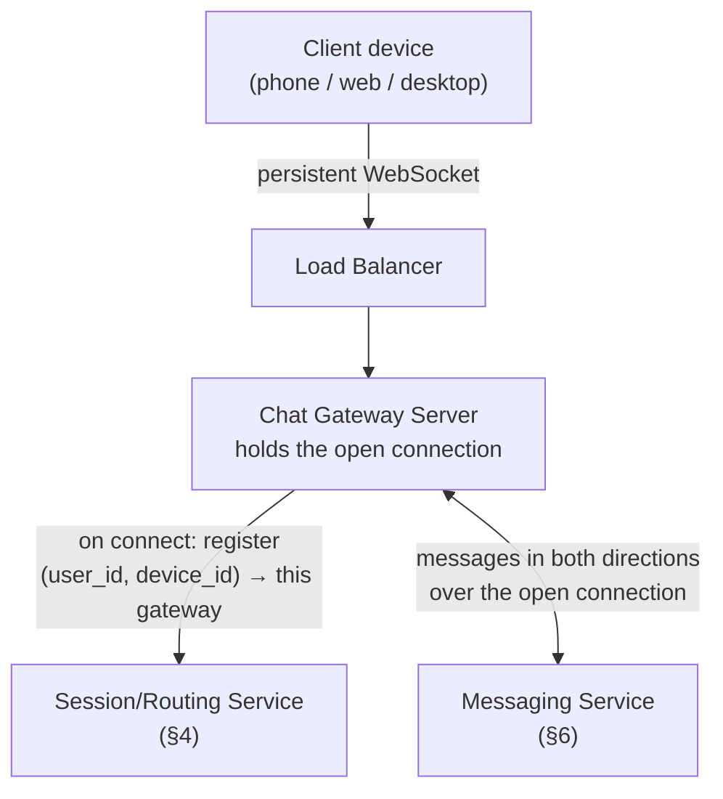
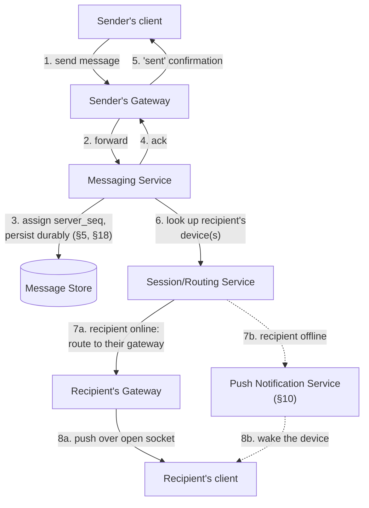

# Designing a Chat System

## 1. Overview and Goals

A chat system lets users exchange messages in real time, one-to-one or in groups, across multiple devices, with messages delivered reliably whether the recipient is online right now or offline for days — WhatsApp, Messenger, Slack, and Signal are all instances of this same underlying problem. The defining characteristic that shapes most of the design below is the opposite of a social feed's: a chat system isn't read-heavy in the way a feed is — a message sent to one person is read roughly once, by that one person — but it is *connection*-heavy and *latency*-sensitive in a way a feed isn't: millions of clients hold open, persistent connections waiting for a message that might arrive at any instant, and the whole point of the product is that it arrives in near real time when the recipient is there to receive it.

**Functional requirements:**

- Users can send and receive text messages one-to-one and in groups.
- Message delivery is tracked through states the sender can see: sent, delivered to the recipient's device, and read by the recipient.
- A user can be logged in on multiple devices (phone, desktop, web) simultaneously, and every device stays in sync.
- Messages sent while the recipient is offline are delivered once they come back online, and the recipient is notified (push notification) even if the app isn't open.
- Users can see others' online/offline/"last seen" status, and typing indicators while someone is composing a reply.
- Messages can include media (images, video, files), not just text.
- Message history is retrievable and searchable.

**Non-functional requirements:**

- **Low latency for online delivery**: a message sent to someone who's currently online should arrive in well under a second — the product's entire value proposition is "real time."
- **Durability**: a message must never be lost, even if the recipient is offline for days, a server crashes mid-delivery, or the sender's own connection drops right after sending.
- **Strict per-conversation ordering**: messages within one conversation must appear in the same, consistent order for every participant, regardless of which server happened to handle which message.
- **No duplicate or dropped messages**: a network retry after a dropped connection must not result in the recipient seeing the same message twice, and a server crash mid-send must not silently drop it either.
- **Massive concurrent-connection scale**: hundreds of millions of devices holding an open, persistent connection at any given moment, independent of how many messages are actually flowing through them.
- **Multi-device consistency**: an action on one device (reading a message, for instance) needs to be reflected on the user's other devices too, not just acknowledged to the sender.

These requirements pull against each other in a specific way worth naming up front: durability wants every message safely persisted before anything else happens, while low latency wants the recipient to see it the instant it's sent — reconciling "persist it safely first" with "deliver it instantly" without picking one at the expense of the other is the first real design tension this system poses, and it resurfaces in slightly different shapes throughout the rest of this document (groups, offline delivery, multi-device sync).

## 2. Basic Data Model

```
User:
  <user_id, display_name, phone_number_or_handle, created_at>

Device:
  <device_id, user_id, platform: {ios, android, web, desktop}, push_token,
   last_active_at, sync_cursor (highest server_seq received, per conversation, §11)>

Conversation:
  <conversation_id, type: {direct, group}, participant_ids[], created_at,
   latest_seq (monotonically increasing per conversation)>

Message:
  <message_id (client-generated), conversation_id, sender_id, server_seq,
   content (ciphertext, if end-to-end encrypted, §14), sent_at, type: {text, media, system}>

Read State:
  <user_id, conversation_id, read_seq (highest server_seq this user has read, §7)>

Presence:
  <user_id, status: {online, offline}, last_seen_at>
```

Splitting these into separate records matters because each has a genuinely different access pattern. `Message` is written once, by the sender, and needs to be durable and strictly ordered within its conversation; `Presence` changes constantly but only the most recent value ever matters, with no history worth keeping. Notice there's no separate "delivery receipt" record at all: a message is "delivered" to a device exactly when that device's own `sync_cursor` reaches its `server_seq` (§11) — that's state the device already has to track for reconnection, not a second fact that needs writing down again. "Read," by contrast, is a `User`-level fact, not a `Device`-level one (§7, §8): once a person has seen a message on any one of their devices, they've seen it, so it's tracked once per user per conversation, not once per device.

## 3. High-Level Architecture

### 3.1 Connection and Routing Layer



Every device maintains exactly one open, persistent connection to exactly one gateway server, for as long as the app is active. The moment that connection is established, the gateway registers *where* this device is reachable — which specific gateway server holds its socket — in the Session/Routing Service, because any other part of the system that needs to deliver a message to this device has to know which of potentially thousands of gateway servers to hand it to.

### 3.2 Sending a Message



Steps 1–5 are the part the sender waits on: the message is durably persisted and acknowledged before the sender's client is told it was sent, which is the resolution to §1's central tension — durability comes first, and it's fast enough (a single write plus an acknowledgment) that it doesn't meaningfully cost the "real time" feel. Steps 6 onward happen asynchronously from the sender's point of view and take one of two shapes depending on whether the recipient is currently connected (§6, §10).

## 4. Connection and Session Management — Deep Dive

**Why a connection can't just be stateless like an ordinary API request.** An HTTP API server can handle any request from any client, because nothing about the server needs to remember the client between requests. A chat gateway can't work that way: the whole point of the open WebSocket connection is that the server can push a message to the client *without* the client asking for it, which means the message has to be routed to the *one specific server process* that's holding that client's socket open — not to the system in general. This single fact is why a routing layer has to exist at all.

**The Session/Routing Service.** A fast, low-latency key-value lookup — `(user_id, device_id) → gateway_server_id` — updated the instant a device connects or disconnects. When the Messaging Service (§6) needs to deliver a message to a specific device, it looks up this mapping, and if an entry exists, forwards the message to that exact gateway server, which pushes it down the open socket. If no entry exists, the device isn't currently connected, and delivery falls to the offline path (§10) instead. This is a small, extremely hot read path — it's consulted on every single message send, for every recipient device — so it needs to be an in-memory, horizontally-sharded store (sharded by `user_id`, since lookups are always keyed by a specific user's devices) rather than a general-purpose database.

**Connection affinity, and what happens when a gateway server dies.** Because a device's connection lives on one specific server, that server going down (crash, deploy, hardware failure) drops every connection it was holding — there's no way around this, since the TCP connection itself is gone. What the design can control is how fast those clients recover: client libraries are built to detect a dropped connection and immediately reconnect, which a load balancer routes to a *different*, healthy gateway server; that server registers the new `(user_id, device_id) → gateway_server_id` mapping, overwriting the stale one; and the client then runs the catch-up sync described in §11 to fetch anything it might have missed during the gap. The brief window between disconnect and reconnect is handled the same way any offline period is handled — nothing special needs to exist for "briefly offline" versus "offline for a day," which keeps this failure mode from needing its own bespoke logic.

## 5. Message Ordering — Deep Dive

**Why client timestamps don't work.** It's tempting to order messages by the time the client says it sent them, but client clocks drift relative to each other and to the server, sometimes by seconds, occasionally by much more — two messages genuinely sent moments apart, from two different devices, can carry timestamps that disagree about which came first, or even collide exactly. For a feature whose entire value is "show the conversation in the order it happened," ordering that can silently be wrong some of the time isn't acceptable.

**The fix: a server-assigned, per-conversation sequence number.** Every conversation has its own monotonically increasing counter (`latest_seq` in §2's `Conversation` record). When the Messaging Service accepts a message for a conversation, it atomically increments that counter and stamps the message with the resulting value as `server_seq` — not the client's claimed send time. Two messages racing to the same conversation get two different, correctly-ordered sequence numbers no matter how close together they arrived or what either client's clock said, because the assignment happens once, in one place, at the moment the server accepts the write.

**Why per-conversation, not global.** A single global counter shared across every conversation on the platform would have to be incremented by every single message sent anywhere in the system — a single, serialized bottleneck that every write everywhere would contend on. Scoping the counter to one conversation means only messages *within that same conversation* ever contend for the next number, and different conversations' counters are entirely independent, which is also the only ordering guarantee anyone actually needs: nobody expects a message in conversation A to be ordered relative to an unrelated message in conversation B, only that messages within one thread appear in a consistent order for everyone in it.

**Where the counter actually lives, given that the Messaging Service itself is many stateless, horizontally-scaled instances.** The atomicity guarantee has to come from the storage layer, not from application servers coordinating with each other. `Conversation` records (§2, §18) live in a store sharded by `conversation_id`, so a given conversation's counter has a single home: whichever partition owns that `conversation_id`. Any Messaging Service instance, regardless of which one happened to receive a particular send request, issues the same atomic increment-and-return operation against that one row or key — an `UPDATE ... SET latest_seq = latest_seq + 1 ... RETURNING latest_seq` against a relational store, an atomic counter update against a wide-column store, or `INCR` against a single-threaded-per-key store — and the storage layer's own concurrency control (row locking, conditional writes, or single-threaded command execution) is what serializes two concurrent senders correctly, without the application tier ever needing to coordinate with itself. This also explains why it never becomes a platform-wide bottleneck despite looking like a single serialization point: the serialization is scoped to one conversation's realistic concurrent-sender count — a handful of people at most, even in a large group (§9) — never to the platform's full message volume, which is spread across millions of independent conversations each with their own counter.

**This same mechanism already covers group conversations correctly, with no extra machinery.** The counter is keyed by `conversation_id`, not by sender, and a group is simply a `Conversation` record with more participants (§2). If two of a group's five members send within milliseconds of each other, both requests reach the same atomic increment against the same conversation's counter — whichever one executes first gets the next number, the other gets the one after, regardless of which of the group's members sent which or which gateway server either of their connections happens to be on (§4). Ordering is finalized once, centrally, at this single increment step, entirely before fan-out to any of the group's members even begins (§6, §9) — which of the group's devices end up scattered across however many different gateway servers has no bearing on it whatsoever.

## 6. Message Delivery — End to End

1. **Send**: the sender's client transmits the message, including a client-generated `message_id` (§17), to its gateway.
2. **Accept and persist**: the Messaging Service validates the sender is actually a participant in the conversation, assigns `server_seq` (§5), and durably writes the message (§18) before anything else happens.
3. **Acknowledge the sender**: the gateway confirms the send back to the sender's client, which can now show the message as "sent" — this is the end of what the sender waits on.
4. **Route to the recipient(s)**: the Messaging Service looks up each recipient device via the Session/Routing Service (§4).
5. **Online recipient device**: the message is forwarded to that device's specific gateway server and pushed down its open connection; the recipient's client persists it locally and sends a `delivered` receipt back (§7).
6. **Offline recipient device**: no entry exists in the Session/Routing Service, so the message stays durably stored and a push notification is dispatched instead (§10) to prompt the device to reconnect and catch up (§11).
7. **Group conversations**: steps 4–6 repeat for every participant device, following the fan-out strategy in §9 rather than a single recipient.

### 6.1 The Online Delivery Path, in Full

Steps 5 and 6 above are each one sentence, and it's worth giving the online path the same scrutiny §10 (offline) and §11 (reconnection) already get — especially since "online" is the common case this entire product exists to make fast.

**The path when everything is working.** The Messaging Service's lookup against the Session/Routing Service (§4) returns a specific `gateway_server_id` for the recipient device. The Messaging Service hands the message to that exact gateway (typically itself a lightweight, low-latency call, since both are internal services on the same network), and that gateway pushes it down the one open socket it holds for that device — no searching, no broadcast, a direct, addressed handoff from one internal service to one specific process. The recipient's client receives it, persists it locally, and sends a `delivered` receipt back over the same connection (§7). End to end, this is the fast path §1 is built around: a handful of internal network hops, no disk-bound step beyond the persistence that already happened in step 2 before fan-out even started.

**The gap this leaves: a stale routing entry.** The Session/Routing Service's mapping is only as fresh as the last time it was updated, and a connection can die — a dropped network, an app crash, a phone losing signal mid-subway-tunnel — without a clean disconnect event ever reaching the gateway to trigger deregistration. In that window, the registry still says the device is reachable at gateway X, but gateway X no longer actually holds that socket. This is a third, distinct failure shape, different from both of the other two already covered: it isn't "genuinely offline" (§10, where no entry exists at all), and it isn't "the routing service itself is unavailable" (§24.1, where the lookup can't even be performed) — the lookup succeeds and confidently points somewhere wrong.

**The fix.** When the Messaging Service hands a message to gateway X and gateway X discovers it has no such connection open, it reports that failure back explicitly, rather than silently dropping the push — the handoff needs an acknowledgment, not a fire-and-forget call. On that failure, the Messaging Service treats the delivery attempt exactly as it would a genuinely offline device (§10): the message is already durably stored, so nothing is lost, and a push notification is dispatched to prompt the device to reconnect. The stale entry itself gets corrected the same way any reconnect already updates it (§4) — when the device's client notices its connection is gone and reconnects, it registers fresh against whichever gateway it lands on, overwriting the stale mapping, so the window only affects this one in-flight delivery attempt, never deliveries after it. To shrink the window in the first place, gateways run periodic liveness checks (WebSocket ping/pong frames) on every connection they hold, proactively deregistering a device the moment a connection fails to respond, rather than waiting to discover it's dead only when a delivery attempt happens to hit it.

## 7. Delivery and Read Receipts — Deep Dive

**The three states, and who actually generates each one.** *Sent* is generated by the server the instant it durably persists the message (§6 step 2–3) — it says nothing about the recipient at all, only that the message is safely stored, and it's a single, per-message fact with no per-user or per-device dimension to it at all. *Delivered* is generated by the recipient's own device, the moment its client actually receives the message over the socket (or fetches it during catch-up sync, §11). *Read* is generated by the recipient's client when the user actually views the message, typically on a short delay or an explicit scroll/open event, and is the only one of the three tied to genuine user attention rather than infrastructure.

**Delivered is per device, because it's the same fact as that device's own sync progress, not a separate thing to track.** A device only "has" a message once it's actually synced it locally, and sync progress is unavoidably individual per device — a phone that's been online the whole time and a laptop that's been closed for two days are genuinely at different points in the same conversation. So "delivered to device X" isn't a receipt the system writes down as its own fact; it's identical to asking whether `server_seq` for this message is at or below device X's own `sync_cursor` (§2, §11) — state that already has to exist for reconnection to work at all. There's no second write, no separate row: delivered status for a device falls directly out of data this design needs anyway.

**Read is per user, not per device — collapsing it to one watermark is also what makes "jump to the first unread message" trivial.** Reading is an attention event, not a sync event: once a person has seen a message on any one of their devices, they've seen it, so there's no reason to ask the same question again per device. The recipient's client reports the single highest `server_seq` it's read in a conversation, stored once per `(user_id, conversation_id)` (§2); "is this message read" is just a comparison against that one number, and — worth noting explicitly — "what's the first unread message when this chat is opened" is just as cheap: it's the message at `read_seq + 1`, nothing more to compute. A naive design that wrote a read receipt for every message individually wouldn't just cost more to store; finding the first unread message would actually be *harder* with it, since it would mean scanning for the first gap in a set rather than adding one to a number. Collapsing read state to a single watermark isn't a trade-off against this feature — it's what makes the feature cheap.

**How `read_seq` actually gets updated as a user scrolls.** The client doesn't send a server update per message scrolled past — that would turn a scroll gesture into a burst of writes. It tracks locally the highest `server_seq` that's been visible for a short dwell time (so a message that just flashes by isn't counted), and reports that single number to the server only at natural checkpoints — scroll pausing, leaving the screen, backgrounding the app — not continuously. The server applies it as `read_seq = GREATEST(read_seq, incoming_value)` rather than an overwrite, which makes the update commutative and idempotent: out-of-order or dropped updates self-correct on the next one, and concurrent updates from multiple devices of the same user naturally converge on whichever device has read furthest, with no coordination between them needed.

**What this means for group chats.** The sender's "delivered to all" or "read by 8 of 12" indicator is an aggregate over the *other* participants, computed per user, not per device: a participant counts as having read a message once their single `read_seq` has reached its `server_seq`, and counts as having it delivered once at least one of their devices' `sync_cursor`s has — covered in full in §9.

## 8. Multi-Device Sync — Deep Dive

**The problem multi-device support actually creates.** A message addressed to a user with three active devices (phone, laptop, web) needs to reach all three, not just one — and a message *sent* by that user from their phone needs to also appear on their laptop and web session, so all three show the same conversation history. Both directions of this are genuinely the same mechanism: every device registered to a user is, for delivery purposes, a recipient of everything that happens in a conversation they're part of, including their own sends from a different device.

**Mechanically, this folds directly into the fan-out already described in §6.** "Deliver to user X" was never really "deliver to one device" — it was always "deliver to every one of user X's currently-registered devices," looked up via the Session/Routing Service (§4) the same way a recipient's devices are looked up in an ordinary 1:1 message. A 1:1 conversation between two single-device users is simply the smallest possible case of the same fan-out a 50-device, 12-person group conversation uses (§9) — there's no separate code path for "multi-device" versus "single device," only a difference in how many devices a given fan-out touches.

**Keeping read state consistent across devices.** If a user reads a conversation on their phone, their laptop needs to reflect that too — nobody wants to re-read messages their other device already marked read. Because read state is tracked as a single highest-sequence-read value *per user per conversation* (§7), not per device, updating it from any one device is immediately the correct value for all of them; the update just needs to be pushed to the user's *other* active devices (the same fan-out mechanism again) so each one's UI refreshes without the user having to do anything.

## 9. Group Chat Fan-Out — Deep Dive

**Why group size changes the right strategy.** Delivering a message to a group's participants is structurally the same problem as delivering it to one recipient's multiple devices (§8), just with more recipients — and the cost of **write fan-out** (looking up every participant's devices and pushing to each one immediately, §6) scales with group size. For an ordinary group of a few dozen to a couple hundred people, that's a small, fast, bounded number of lookups and pushes — milliseconds of work, invisible as a cost. For a community-style channel with tens or hundreds of thousands of members, pushing one message out as an immediate burst of that many individual deliveries is a write-amplification problem: one write action (sending the message) turns into an unboundedly large number of downstream writes, bounded only by how many members happen to be in the room.

**The fix: a size-based hybrid, not one strategy for every group.** Below a configurable member-count threshold, write fan-out runs as described in §6 — direct, immediate delivery to every participant's devices. Above the threshold, the message is instead written once to the conversation's message store (§18) and members read it via the ordinary catch-up/sync mechanism (§11) rather than having it pushed to them individually — a **read fan-out**, the same "write once, let interested parties pull it" principle applied to messaging instead of a social feed. This means a very large channel behaves slightly more like a bulletin board than an instant one-to-one chat — a small, deliberate trade, and the right one, since the alternative (treating a 100,000-member channel exactly like a 5-person group chat) would mean one message triggering 100,000 immediate pushes, repeated for every message sent to that channel.

**Delivery and read receipts don't make sense at that scale either, and the design should say so explicitly.** A "delivered to 90,000 of 100,000, read by 40,000" indicator is neither cheap to compute continuously nor useful to show anyone — large channels typically drop per-member delivery/read tracking entirely in favor of a simple aggregate view count, rather than trying to preserve §7's exact-receipt model at a scale it was never meant for.

## 10. Offline Delivery and Push Notifications — Deep Dive

**What "offline" actually means operationally.** A device with no entry in the Session/Routing Service (§4) — no open connection — is offline from the system's point of view, whether that's because the app is fully closed, the device has no network, or the OS has suspended the app in the background. In every one of these cases, the message still gets durably persisted (§6 step 2) exactly as it would for an online recipient; what's different is only how the recipient finds out about it.

**The push notification as a wake-up signal, not a delivery mechanism.** The system dispatches a lightweight notification (through the platform's own push service — APNs for iOS, FCM for Android) containing just enough to alert the user and prompt the OS to wake the app, not the message content itself for an end-to-end encrypted conversation (§14) where the push-notification infrastructure, operated by a third party, must never see plaintext. When the user taps the notification (or the OS wakes the app proactively), the app reconnects, which re-registers it in the Session/Routing Service and immediately triggers the catch-up sync in §11 to actually fetch the message — the push notification's only job is getting the app connected again; the real delivery happens through the ordinary connected-client path once it is.

**Why this has to be a separate concern from the WebSocket delivery path, not a fallback bolted onto it.** A push notification can be delayed, dropped, or rate-limited by the OS vendor in ways entirely outside this system's control, and a user might also simply open the app on their own, unprompted by any notification, long after a message arrived. Because durability (§6) already guarantees the message is safely stored regardless of whether a push notification ever successfully arrives, the push notification is purely a best-effort nudge to reduce the time until the next sync, not something the delivery guarantee depends on — a dropped push notification is a worse user experience (the user finds out later than they might have), never a lost message.

## 11. Reconnection and Catch-Up Sync — Deep Dive

**The problem.** A device that was offline — for ten seconds or ten days — needs to catch up on everything it missed without re-fetching the entire conversation history from the beginning every time, and without missing anything in the gap.

**The fix: a per-device sync cursor, analogous to the per-conversation sequence number that already makes ordering well-defined (§5).** Each device tracks the highest `server_seq` it has successfully received, per conversation (or a single global watermark across all of a user's conversations, depending on how sync is scoped). On reconnect, the device sends that cursor back to the server as part of re-establishing its session; the server responds with everything whose `server_seq` is greater than the cursor, across every conversation the device participates in, and the device's cursor advances to match once it's processed the response. A device reconnecting after ten seconds gets back nothing or one message; a device reconnecting after ten days gets back ten days of missed messages, through the exact same request shape — the mechanism doesn't need to know or care how long the gap was.

**Why this is also what makes a dropped WebSocket connection harmless rather than a source of lost messages.** §4 already establishes that a gateway server dying drops every connection it was holding; this is the mechanism that makes that survivable. The client doesn't need to know *why* it disconnected — a crashed gateway, a flaky mobile network, the user closing their laptop — because reconnecting and presenting its last-known cursor recovers exactly the same way regardless of cause. This is also why the sync cursor, not the open connection itself, is the thing actually responsible for the "no dropped messages" guarantee in §1 — the connection is just the fast path when it happens to be up.

## 12. Presence: Online/Offline and Last Seen — Deep Dive

**Why broadcasting every presence change to everyone interested is the wrong default.** A naive design pushes "user X just came online" to every one of X's contacts the instant it happens — but a popular account or a large group means this is itself a fan-out problem shaped like §9's, triggered by something as routine as unlocking a phone, for a feature (seeing a green dot) that most viewers aren't even looking at in that exact moment.

**The fix: compute presence mostly on demand, not proactively broadcast it.** Presence is written cheaply and frequently (a device's connection state in the Session/Routing Service, §4, already implies online/offline for free) but *read*, for the most part, only when a user actually opens a specific conversation — at that moment, the client asks for the current presence of the specific other participant(s) in view, a cheap, targeted point lookup, rather than the server having proactively pushed that update to everyone who might ever care. A live update *while* a conversation is open (so a green dot updates in real time without the user needing to refresh) is a small, bounded push — to however many people currently have that specific conversation open, not to the user's entire contact list — which keeps the cost proportional to active interest rather than total audience size.

**Last-seen timestamp and privacy.** Because exact online/offline status and a last-seen timestamp can reveal more about a person's behavior than they'd like (they're clearly avoiding a message, they're awake at 3am), this is commonly a per-user, configurable visibility setting rather than a system-wide default — a filter applied at the read point in the paragraph above (who's allowed to see this user's presence at all), not a change to how presence itself is computed or stored.

## 13. Typing Indicators

A typing indicator is the one feature in this entire design that's deliberately given *no* durability guarantee at all — it's useful only in the instant it's shown, carries no meaning once stale, and is actively wrong if delivered late (showing someone was typing ten seconds ago, after they've already sent or given up, is worse than not showing it at all). It's sent as a lightweight, best-effort, unacknowledged message over the same open connection used for everything else (§3), scoped only to participants who currently have that conversation open, and the client auto-expires it a few seconds after the last signal if no further typing activity follows — there's no retry, no persistence, and no need for either, since a dropped typing indicator has no lasting consequence the way a dropped message would.

## 14. End-to-End Encryption — Deep Dive

**What end-to-end encryption actually changes architecturally.** In every section so far, "the server" has been able to reason about message content — routing it, storing it, counting it. End-to-end encryption means the server only ever sees ciphertext: it can still route, persist, and order encrypted blobs by `conversation_id` and `server_seq` exactly as described in §5–§6, but it can never read, search, or filter the content itself, because only the sender's and recipients' devices hold the keys needed to decrypt it. Everything about delivery, ordering, and fan-out already described works identically whether or not the payload is encrypted — encryption changes *what's inside* `Message.content`, not how the message is routed or stored.

**Establishing a shared secret between two devices that may never be online at the same time.** Two users starting a conversation can't do a live, interactive key exchange if one of them is offline — the standard solution (an X3DH-style handshake) has each device publish a small bundle of public keys in advance (a long-term identity key plus a batch of one-time pre-keys) to the server, purely as a public key directory; a device wanting to start a conversation fetches the other side's current bundle, even while that device is completely offline, and derives a shared secret from a combination of those keys. This is why key *distribution* can go through the same always-available server infrastructure as everything else, without that server ever learning the resulting secret itself.

**Keeping every message forward-secure, not just the first one.** Encrypting every message in a conversation under one single long-lived key would mean a single device compromise exposes the entire message history, past and future. A double-ratchet scheme instead derives a brand-new encryption key for every single message, each one mathematically derived from the last but not reversible back to it — so compromising today's key reveals today's messages but not yesterday's (forward secrecy) and, because the ratchet keeps advancing with fresh randomness, a compromise doesn't permanently compromise future messages either once the ratchet has moved on again (post-compromise security).

**Why group encryption doesn't scale the same mechanism naively.** Pairwise double-ratchet sessions work cleanly for two parties; a group of N people doing full pairwise encryption between every pair would need N×(N−1) sessions, growing quadratically with group size. The common fix (a "sender key" approach) has each participant generate their own symmetric key for the group and distribute it to every other member once, pairwise, at the time they join — after that one-time distribution, a sender encrypts a group message once, with their own key, and every member decrypts it with the sender's previously-distributed key, turning the ongoing cost back into linear (one encryption, N decryptions) rather than paying the pairwise cost on every single message.

**The trade-off worth naming explicitly.** End-to-end encryption and several features described elsewhere in this document are now in direct tension: server-side message search (§16) can't inspect plaintext to index it, spam/abuse content filtering can't inspect message bodies before delivery, and any server-side feature that depends on understanding *what* was said — rather than just routing and storing an opaque blob reliably — either has to move entirely onto the client (search indexes built and kept locally on-device) or simply isn't possible without weakening the encryption guarantee. This is a real product trade-off, not a detail to gloss over.

## 15. Media Messages and CDN

A message containing an image, video, or file follows a two-step pattern: the client uploads the media to object storage first (encrypted client-side under its own key, for an end-to-end encrypted conversation, §14) and receives back a reference (an object key or URL plus the decryption key, itself delivered inside the encrypted message payload); the actual chat message that gets sent, ordered, and delivered through §5–§6 is a small, ordinary payload carrying that reference, not the media bytes themselves. Recipients fetch the media directly from object storage (fronted by a CDN for anything shared broadly, such as a sticker or a file in a large group) using the reference and key carried in the message — keeping the latency-sensitive messaging pipeline free of large binary payloads entirely.

## 16. Message Search

For a system that isn't end-to-end encrypted server-side, message search is an ordinary text-indexing problem: index message content by conversation and by participant as messages are written, and query that index directly. For an end-to-end encrypted system (§14), the server fundamentally cannot build this index, since it never sees plaintext — search instead has to be built and maintained entirely on-device, indexing each conversation's messages locally as they're decrypted and received, with search queries never leaving the device. This is a direct, unavoidable consequence of §14's trade-off, not a separate design choice.

## 17. Idempotency and Deduplication

A client that sends a message and loses its connection before receiving an acknowledgment (§6 step 3) can't tell whether the server actually received it or not, and the only safe client behavior is to retry — which means the server has to be able to recognize a retried send as the *same* message, not a new one. The fix is the same pattern used for any at-least-once-prone write path: the client generates its own `message_id` (§2) before the first send attempt, and reuses that exact ID on every retry of that same logical send. The Messaging Service checks for an existing message with that ID before persisting a new one; if found, it simply re-sends the acknowledgment for the already-persisted message rather than writing a duplicate. This is the only point in the pipeline that needs explicit deduplication — once a message is durably persisted under its client-generated ID, every downstream step (fan-out, receipts, sync) refers back to that same ID and never has reason to create a second copy of it.

## 18. Storage Layer — Deep Dive

**The message store.** Messages are partitioned by `conversation_id`, with `server_seq` as the sort/clustering key within that partition — the composite-key shape that falls directly out of §5's ordering design and §11's sync mechanism, both of which are always asking the same question ("give me this conversation's messages after sequence X") rather than ever needing a scan across unrelated conversations. This is a write-heavy, append-only log, well suited to a wide-column or log-structured store, with no updates to existing rows ever needed — a sent message's content never changes once persisted, so the store never has to handle a concurrent-update race the way a mutable field would.

**Why this key shape favors a wide-column, LSM-tree-based store specifically.** Stores like Cassandra, ScyllaDB, DynamoDB, or HBase are built around sequential appends to a commit log and an in-memory table, flushed periodically to immutable files and compacted in the background — a near-exact match for a workload that only ever appends and range-scans forward, never updates in place. A catch-up query ("give me this conversation's messages after sequence X," §11) becomes a single-partition range scan bounded by the page size requested (say, 50 messages), not a scan of the conversation's full history — equally cheap whether the conversation has 200 messages or 200,000.

**The unbounded-partition problem, and the fix.** An extremely long-lived, high-volume conversation would otherwise grow a single partition without limit, and wide-column stores specifically dislike that — an oversized partition gets slow to compact and creates a hot spot on whichever nodes hold it. The practical fix is to extend the partition key with a time bucket, e.g. `(conversation_id, year_month)`, so a single conversation rolls over into a fresh partition periodically instead of growing one forever; a client query that happens to straddle a boundary just reads across the one or two adjacent buckets involved.

**Durability and consistency for writes.** Each partition is replicated across multiple nodes, typically spread across availability zones, and a write isn't acknowledged back to the gateway (§6, step 2–3) until a quorum of replicas have durably stored it, not just one — this is what backs the "a message must never be lost" requirement from §1. Reads can safely use a weaker consistency level than writes, since an already-delivered message's content never changes; this read/write asymmetry is the normal tuning point these stores are built around, not something specific to chat.

**Hot/cold tiering and retention.** Keeping years of history in the same low-latency store absorbing 230,000 writes/second (§19) is wasteful, since the overwhelming majority of reads are for recent messages during active sync. The usual pattern is to keep recent messages (the last several months, say) in the primary hot store and age older messages out to cheaper object storage, with a separate, slower read path serving genuinely old history — rather than trying to keep one store simultaneously cheap and fast across the entire dataset's lifetime.

**The read-state store.** Because §7 tracks read state as a single highest-sequence-read watermark per `(user_id, conversation_id)` rather than a row per message, this store is small and cheap regardless of message volume — bounded by `users × conversations per user`, not by message count, so it stays a small fraction of the message store's footprint even at hundreds of millions of users. There's no separate "delivered" store at all: delivered status is read directly off each `Device`'s own `sync_cursor` (§2, §11), which already has to exist for reconnection and needs no additional table of its own. What this store does need is an atomic conditional write: applying `read_seq = GREATEST(read_seq, incoming_value)` (§7) has to happen as a single atomic operation, not a client-side read-modify-write, or two near-simultaneous updates from two of a user's devices could race and the smaller one could clobber the larger. Most key-value stores support this natively — a conditional update expression in DynamoDB, or a small Lua script or a "set if greater" flag in Redis — so this is a guarantee the storage layer provides directly, not something the application has to coordinate itself.

**The session/routing store.** Covered in full in §4 — an in-memory, `user_id`-sharded key-value store, chosen specifically for its read latency, since it's consulted on every single message fan-out and needs to answer in the time budget of "real time," not "eventually consistent is fine." It's also the one store in this whole design deliberately allowed to be lossy: entries typically carry a short TTL as a second line of defense alongside the gateway ping/pong liveness checks from §6.1, so that even a gateway crash severe enough to never report a stale connection still self-corrects once the TTL expires, rather than leaving a wrong mapping in place indefinitely.

**Where the smaller, more ordinary data lives.** `User`, `Device`, and `Conversation` metadata (§2) don't have the message store's extreme write-throughput profile, so they don't need the same specialized treatment — a conventional relational database or managed document store is a fine fit. Group membership is the one piece worth calling out specifically, because it's really two different access patterns on the same relationship: "who's in conversation X" (needed for fan-out, §9) and "which conversations is user X in" (needed when a client launches and has to sync everything, §11) read in opposite directions. That's typically modeled as its own membership table keyed one way with a secondary index the other way, rather than trying to serve both directions off a single `participant_ids` list sitting on the `Conversation` record.

**Why none of these should share infrastructure.** Each has a genuinely different profile: the message store is write-heavy and permanent; the read-state store is tiny and infrequently overwritten; the session store is entirely transient (a server crash can safely wipe it, since every client reconnects and re-registers itself anyway, per §4) and needs the lowest latency of the three; and the metadata store is small, relatively static, and needs none of the write-throughput tuning the message store does. Forcing them into one storage system would mean tuning for incompatible workloads at once, when each is cheap to run well on its own.

## 19. Capacity Estimation

Assume a platform with 500 million daily active users, averaging 40 messages sent per user per day, with roughly a third of all users connected concurrently at peak.

- **Message throughput**: `500,000,000 × 40 / 86,400 ≈ 230,000` messages/second sustained average, with peak traffic during regional daytime hours running several times higher.
- **Concurrent connections**: roughly 165 million simultaneous open connections at peak (a third of DAU). At a realistic, well-tuned capacity of 50,000–100,000 active connections per gateway server (bounded by memory and file descriptors more than raw CPU), that's on the order of 2,000–3,000 gateway servers needed just to hold connections open, independent of message volume.
- **Fan-out multiplier**: with an average of 1.5 active devices per user and typical group sizes adding further multiplication for group messages, actual deliveries run at several times the raw message-send rate — the reason §9's group-size threshold matters as more than a theoretical concern.
- **Message storage**: at 230,000 messages/second sustained and a few hundred bytes per message (text; media is stored and sized separately, §15), raw message storage grows by tens of terabytes per month, which is why durability and retention policy (how long old messages stay in the hot store versus cold archival storage) matter at this scale the same way they do for any high-volume write-heavy log.

These numbers motivate the two decisions this design keeps returning to: the connection count — not the message rate — is what drives gateway-layer capacity planning, which is why §4's routing layer and connection affinity get as much attention as message throughput does; and the fan-out multiplier from multi-device (§8) and groups (§9) is why "messages sent per second" understates the system's real delivery workload by a meaningful factor.

## 20. Monitoring and Metrics

Key operational signals: end-to-end delivery latency from send to the recipient's "delivered" receipt (the single most direct measure of whether the product's "real time" promise is being met); connection churn rate per gateway server (a spike suggests a bad deploy or a network-wide client issue, not organic behavior); Session/Routing Service lookup latency (since it sits on the hot path of every fan-out, §4); sync-cursor lag after reconnection (how far behind a reconnecting device typically is, which reflects both typical offline duration and how efficiently catch-up sync, §11, is performing); and push-notification delivery and open rates per platform (a sustained drop for one platform specifically points at an APNs/FCM-side issue rather than this system's own fault).

## 21. Security and Compliance

- **End-to-end encryption (§14) means the server is architecturally incapable of reading message content**, which is itself the strongest privacy guarantee this design offers — not a policy promise, but a property of what data the server ever possesses.
- **Metadata (who messages whom, when, how often) is not protected by message encryption and is worth naming as a separate concern.** Even with content fully encrypted, the Session/Routing Service, delivery receipts, and message timestamps together reveal a real social graph and communication pattern — minimizing how long this metadata is retained, and who internally can query it, matters independently of the encryption guarantee on content.
- **Push notification payloads must never leak plaintext** (§10) to the third-party push infrastructure (APNs/FCM) for an end-to-end encrypted conversation — the notification can say "new message from Alex," never the message itself.
- **Rate limiting message sends** protects against spam/abuse the same way any high-throughput write path needs protecting from a single bad actor, independent of whatever content-level filtering end-to-end encryption rules out (§14).

## 22. Summary Table

| Goal / Problem | Technique |
|---|---|
| Routing a push to the one server holding a client's live connection | Session/Routing Service mapping `(user_id, device_id) → gateway server` |
| Consistent message order within a conversation despite client clock drift | Server-assigned, per-conversation monotonic sequence number |
| Fast sender feedback without sacrificing durability | Persist and acknowledge before async fan-out to recipients |
| Cheap read-state tracking at scale | Highest-sequence-read watermark per user per conversation, not per-message receipts |
| One user, many devices, all in sync | Devices as the real unit of delivery; every device is a fan-out target |
| Very large groups/channels without per-message write explosion | Size-based hybrid: write fan-out below a threshold, read fan-out above it |
| Reliable delivery to an offline device | Durable storage regardless of connection state + push notification as a wake-up nudge, not the delivery mechanism |
| Recovering cleanly after any disconnect, long or short | Per-device sync cursor against the per-conversation sequence number |
| No duplicate messages under client retries | Client-generated, retry-stable idempotency key (`message_id`) |
| Confidentiality the server itself can't violate | End-to-end encryption (X3DH + double ratchet, sender keys for groups) |
| Presence that doesn't fan out to an entire contact list on every status change | Compute mostly on demand, push live updates only to currently-open conversations |

## 23. Interviewer's Guide: Follow-Up Questions

**On connections and routing:**
- Why can't a chat gateway be a stateless, horizontally-scaled API server the way a typical REST service is? What specifically breaks?
- A gateway server crashes while holding 50,000 open connections. Walk through, precisely, what happens to each of those clients and how they recover.

**On ordering and delivery:**
- Why not just use the client's send timestamp to order messages? What concretely goes wrong?
- Design the exact sequence of events for a message sent while the recipient is offline, from send to the sender eventually seeing a "read" receipt.

**On multi-device and groups:**
- A user reads a conversation on their phone. Walk through exactly how their laptop's unread badge updates, and why it doesn't need a receipt row per message.
- At what group size would you switch from write fan-out to read fan-out, and what would you actually measure to validate that threshold?

**On reliability:**
- A client retries a send after a timeout, but the original send actually succeeded server-side. Does the recipient see one message or two? Why?
- Why is the push notification explicitly *not* part of the delivery guarantee? What would go wrong if the design depended on it?

**On encryption:**
- If messages are end-to-end encrypted, what can the server still legitimately do with a message it's routing? What can it never do?
- Why can't a group of 500 people just run 500 individual pairwise encrypted sessions the way a 1:1 chat does?

**Concepts worth raising even if the candidate doesn't bring them up:**
- **The connection-routing problem is the single most distinguishing feature of this system versus a typical request/response API** — a candidate who jumps straight to message storage without first addressing how a server pushes to a specific live client hasn't engaged with what makes chat systems architecturally different.
- **Durability has to come before the "real-time" feel, not compete with it** — persisting and acknowledging a message before fan-out is what makes "sent immediately" and "never lost" compatible goals rather than a trade-off.
- **End-to-end encryption is a genuine trade-off, not a free security upgrade** — a strong candidate should name what it costs (server-side search, content moderation) as readily as what it buys.

## 24. A Critical Second Look: Gaps Worth Naming Out Loud

### 24.1 The Session/Routing Service is a single point of hot-path dependency for every message sent

**The problem.** Every message fan-out in this design — 1:1, multi-device, or group — depends on a lookup against the Session/Routing Service (§4) to find out where to deliver it. If that service is slow or briefly unavailable, it doesn't just degrade one feature; it stalls the delivery half of every single message in flight platform-wide, even though the messages themselves are safely persisted (§6) and in no danger of being lost. The design as described doesn't say what a fan-out attempt should do when this lookup itself fails or times out.

**The fix.** A failed or timed-out routing lookup should be treated the same way an offline recipient is treated (§10) — fall back to "assume this device is unreachable right now, rely on the durability guarantee and catch-up sync (§11) to deliver it once the device is confirmed reachable again" — rather than blocking or retrying the lookup indefinitely. This costs a small amount of delivery latency during a routing-service degradation, in exchange for never letting a dependency outage turn into message loss, consistent with how every other failure mode in this design is handled: degrade latency, never correctness.

### 24.2 Read receipts and the highest-sequence watermark break under out-of-order delivery across devices

**The problem.** §7's "highest sequence read" design assumes a user reads messages roughly in order — but a user with multiple devices could plausibly jump to the newest message on their phone (marking a high sequence number as read) without ever having opened an earlier, unread message still sitting in the middle of the conversation on their laptop. Because the watermark is a single number, not a set, there's no way to represent "read everything except message #32" — the design as described would incorrectly treat #32 as read once a later message is marked read, even though the user never saw it.

**The fix.** This is a real, accepted trade-off in most production chat systems rather than a flaw to fully engineer around — the alternative (tracking read state as a set of specific message IDs rather than a single watermark) reintroduces the per-message storage cost §7 was specifically designed to avoid, for a scenario (reading out of order across devices) that's genuinely rare in practice. Worth naming explicitly as a deliberate simplicity-for-correctness trade, the same kind of honest trade-off a strong candidate should volunteer rather than let an interviewer discover by probing.

### 24.3 The group "sender key" encryption scheme has a membership-change problem the design doesn't address

**The problem.** §14's sender-key approach for group encryption distributes each member's key to every other member once, at the time they join — but it doesn't say what happens when someone *leaves* a group. Without an explicit step to rotate keys on departure, a removed member who retained the group's sender keys from their time as a participant could still decrypt messages sent after their removal, since nothing about leaving the group invalidates keys they already received.

**The fix.** Membership changes need to trigger key rotation: when a member leaves (or is removed), remaining members generate and redistribute fresh sender keys, so a departed member's retained keys only ever decrypt messages from before they left, never after. This adds real cost — a membership change in a large group means a fresh round of key distribution to every remaining member, the same N-recipient cost §14 already accepts for a new member joining — but omitting it would mean "remove from group" silently fails to revoke access to future messages, which is a meaningfully worse privacy guarantee than the feature appears to promise.

## References

1. Chat system architecture and connection management: [Design WhatsApp / Chat Messaging: A Full System Design Interview Walkthrough](https://www.designgurus.io/system-design-interview/questions/chat-messaging)
2. WebSocket gateway and session-routing design: [Design a Messaging App Like WhatsApp](https://www.hellointerview.com/learn/system-design/problem-breakdowns/whatsapp)
3. Message ordering via server-assigned sequence numbers and read-receipt watermarks: [Most candidates overcomplicate designing a chat system](https://engineeringenablement.substack.com/p/most-candidates-overcomplicate-designing)
4. Chat application architecture, scalability, and message ordering: [Chat Application Architecture - Scalability, message ordering & diagrams](https://getstream.io/blog/chat-application-architecture/)
5. Group chat fan-out strategies by group size: [How to Design a Real-Time Chat Application (WhatsApp/Slack) — System Design Interview](https://www.designgurus.io/blog/design-chat-application)
6. Signal Protocol, X3DH, and the Double Ratchet algorithm: [Signal Protocol — Wikipedia](https://en.wikipedia.org/wiki/Signal_Protocol)
7. WebSocket connection capacity and scaling limits per server: [WebSockets at Scale: Architecture for Millions of Connections](https://websocket.org/guides/websockets-at-scale/)
