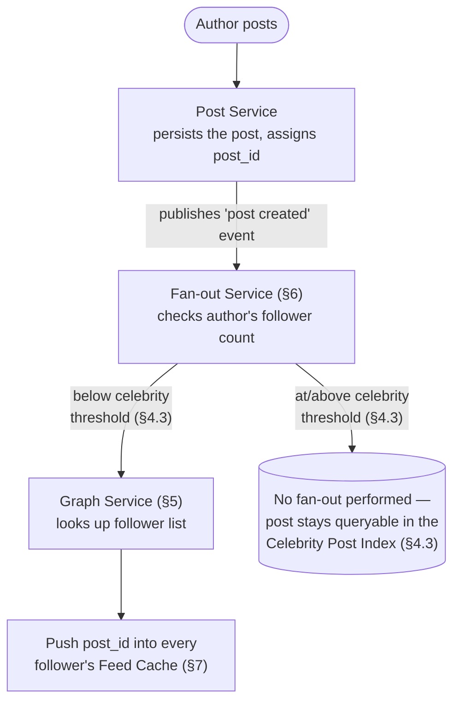
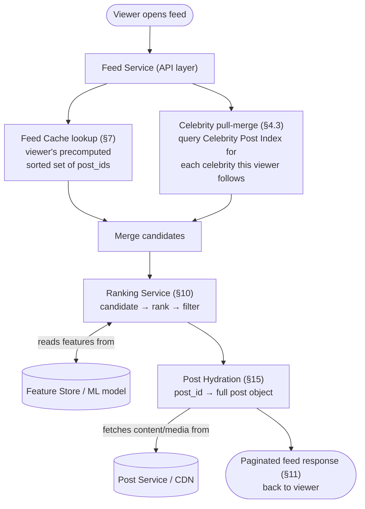

# Designing a News Feed System

## 1. Overview and Goals

A news feed system lets users publish posts (text, images, video, links) and shows each user a ranked, continuously-updating stream of posts from the people and pages they follow — Facebook's News Feed, Twitter/X's timeline, Instagram's feed, and LinkedIn's feed are all instances of the same underlying problem. The defining characteristic that shapes almost every design decision below is the read:write ratio: users scroll their feed far more often than they post, and a single post, once published, can be *read* by anywhere from zero to tens of millions of people depending on who posted it.

**Functional requirements:**

- Users can create posts (text, media, links) and the system fans them out to the right audience.
- Users can follow/unfollow other users or pages; a feed shows posts from accounts the viewer follows.
- A feed request returns a page of posts, ranked either chronologically or by predicted relevance, with support for infinite scroll (pagination).
- Users can like, comment on, and share posts; these interactions both display on the post and feed back into ranking.
- Unfollowing someone or deleting a post should (eventually) stop that content from appearing in anyone's feed.

**Non-functional requirements:**

- **Extremely read-heavy**: a realistic read:write ratio for a social feed is on the order of 100:1 — users check their feed far more often than they post, and every post is read by many more people than the one who wrote it.
- **Low read latency**: a feed request should return in well under a second, even while scrolling continuously (pagination) and even for a user who follows thousands of accounts.
- **High write throughput, concentrated unevenly**: most users post rarely to a small audience, but a small number of "celebrity" accounts post to tens of millions of followers at once — the single biggest architectural challenge in this entire system traces back to this skew.
- **Eventual consistency is acceptable, and expected**: a new post appearing in a follower's feed a few seconds late, or a like count being briefly stale, is normal and unnoticeable; this is nothing like a banking ledger that needs strict consistency.
- **Scalability**: hundreds of millions of daily active users, each with a social graph that can range from a handful of connections to tens of millions.
- **Freshness and ranking, not just storage**: a feed isn't just "show me everything in order" — it's a ranking problem balancing recency, relevance, and diversity, layered on top of a storage and fan-out problem.

These requirements pull against each other in a specific, well-known way: optimizing for fast reads (precompute everything, push it to every follower immediately) directly conflicts with controlling write cost (a celebrity's post would need to be written into tens of millions of individual feeds at once). Reconciling that tension — not just picking one side — is the central design problem a news feed system poses, and is explored in full in §4.

## 2. Basic Data Model

```
User:
  <user_id, username, display_name, created_at, follower_count, following_count>

Follow Edge:
  <follower_id, followee_id, created_at>

Post:
  <post_id, author_id, content_text, media_urls[], created_at,
   like_count, comment_count, share_count, visibility: {public, followers, private}>

Feed Entry (precomputed, per viewer):
  <viewer_id, post_id, author_id, score (timestamp or rank), inserted_at>

Interaction (like/comment/share):
  <interaction_id, post_id, actor_id, type: {like, comment, share}, content (for comments), created_at>
```

Splitting these into separate concerns matters because each record type has a different size, update frequency, and access pattern: a `Post` is written once and read enormously often (by every viewer who ever sees it in a feed), a `Follow Edge` is read constantly (to compute fan-out and to merge pull-based feeds) but written rarely, and a `Feed Entry` is a derived, denormalized structure that exists purely so a feed read never has to join `Post` against `Follow Edge` at request time — doing that join live, for every feed request, at the scale this system operates at, would be the single most expensive possible way to serve a feed.

## 3. High-Level Architecture

A post's journey through this system has two independent halves that are easy to conflate but solve different problems: the **write path** decides *where a post's ID gets stored* so it can be found quickly later; the **read path** decides *what to show and in what order* once a viewer asks for their feed. The fan-out decision (push vs. pull, §4) only affects the write path; ranking (§10) only affects the read path; they compose independently, which is exactly why they're drawn as two separate diagrams below rather than one.

### 3.1 Write Path: Author Posts



Reading this left to right: every post always goes through the Post Service and the Fan-out Service, which then makes exactly one decision — the author's follower count, checked against the celebrity threshold (§4.3) — and that single decision determines which of the two branches a given post takes. Nothing else in the write path is conditional.

### 3.2 Read Path: Viewer Opens Feed



Reading this top to bottom: a feed request always runs down two parallel tracks at once — the viewer's own precomputed feed, and a direct pull against whichever celebrities they follow — and those two tracks always merge back into one candidate list before ranking ever runs. Ranking and hydration are not conditional on anything; every request passes through both, in that order, regardless of which branch above produced a given candidate.

## 4. Feed Generation Strategies — Deep Dive

This is the single most consequential decision in the whole design, and the one most worth defending precisely in an interview rather than asserting by name.

### 4.1 Fan-out-on-write (push model)

When a user posts, the system immediately looks up every follower of that user (via the Graph Service, §5) and writes the new post's ID into each follower's precomputed feed (§7) right away — so by the time any follower opens their feed, the post is already sitting there waiting, and a feed read is just a cheap lookup of an already-materialized list.

**Why this is good for reads.** A feed request never has to compute anything at read time — it's a single lookup against a structure built exactly for fast ordered retrieval (§7). This is why push is the default choice: reads vastly outnumber writes (§1), so paying a cost at write time to make every subsequent read cheap is the right trade for the overwhelming majority of accounts.

**Why this breaks down for celebrities.** A regular user might have 500 followers — fanning out one post means 500 small writes, trivial. A celebrity account with 50 million followers turns *one* post into 50 million individual feed-cache writes, all triggered by a single API call. That's not just a large number — it's a write amplification problem that scales with follower count, meaning the system's write cost for a single action is no longer bounded by anything the author did; it's bounded by an arbitrary, unbounded property of their audience.

### 4.2 Fan-out-on-read (pull model)

The opposite approach: do nothing at write time beyond persisting the post itself. When a viewer requests their feed, the system looks up everyone they follow (via the Graph Service) and queries each of those accounts' recent posts directly, merging the results by recency (or score) on the fly.

**Why this is good for writes.** Posting is just a single write to the `Post` table, regardless of how many followers the author has — no fan-out cost at all, so a celebrity posting doesn't create any special-case load.

**Why this is bad for reads.** A viewer who follows 2,000 accounts needs their feed request to query (or at least touch) up to 2,000 different authors' recent posts and merge them — on every single feed request, from every single user, for a system where reads outnumber writes 100:1. This inverts the cost to exactly the side of the ratio that can least afford it.

### 4.3 The hybrid approach (what real systems actually run)

Production systems split the account base by a follower-count threshold and treat the two groups differently: **push (fan-out-on-write) for ordinary accounts**, and **pull (fan-out-on-read), merged in at request time, for a small set of celebrity accounts** above the threshold (commonly somewhere in the range of 10,000+ followers, tuned per platform).

Concretely: when account A posts, the Fan-out Service (§6) checks A's follower count. Below the threshold, it fans out normally — pushing the post into every follower's precomputed feed cache. Above the threshold, it skips fan-out entirely and simply records the post in a **celebrity post index** (effectively just the normal `Post` table, filterable by author and recency). Then, at read time, a viewer's feed is assembled by taking their precomputed feed (covering everyone they follow who's below the threshold) and merging in — only at that moment, only for that one viewer's request — the most recent posts from whichever celebrities they happen to follow, by directly querying the celebrity post index for those specific few accounts.

**Why this is the right trade, not just a compromise.** The cost of pull-merging is now bounded by *how many celebrities a single viewer follows* (almost always a small, tractable number — dozens at most, not thousands), not by *how many followers a celebrity has* (which is unbounded and exactly the dimension push handles so badly). Each side of the hybrid is handling the dimension it's actually good at: push absorbs the long tail of ordinary accounts with moderate follower counts, where fan-out cost stays small; pull absorbs the short head of celebrity accounts with enormous follower counts, where the cost of pull-merging a handful of extra authors per read stays small too. Neither side is ever asked to do the thing it's bad at.

**Worked example.** A platform has 500 million users. A user with 300 followers posts: ~300 writes into feed caches, done in milliseconds, invisible as a cost. A celebrity with 50 million followers posts: zero fan-out writes — just one row in the `Post` table — and the cost instead shows up as a marginally more expensive read for each of that celebrity's followers' *next* feed request, each of which only has to pull-merge that one celebrity (plus however many others that specific viewer follows), not all 50 million followers at once. The total system-wide cost of that celebrity's post is spread thinly across many cheap reads instead of concentrated into one enormous write burst.

## 5. Graph (Follow/Follower) Service — Deep Dive

Every other part of this system depends on answering two questions fast: "who follows user X" (needed by the Fan-out Service, §6, to know who to push a post to) and "who does user X follow" (needed by the pull-merge path, §4.3, and by any read-time assembly). These are genuinely different access patterns on the same underlying edge set, and at scale they're often served by separate, denormalized indexes rather than one bidirectional table scanned both ways — an adjacency list keyed by `follower_id` (to answer "who do I follow") and a second, separately-maintained adjacency list keyed by `followee_id` (to answer "who follows me") — because a celebrity's followers list can itself be tens of millions of rows, and reading *that* list is exactly the hot path the Fan-out Service hits on every one of that celebrity's posts.

**Why one table with two indexes isn't the design used.** It's tempting to assume a single edge table — rows of `(follower_id, followee_id)` — with a secondary index on each column would serve both directions well enough. It doesn't, once a celebrity enters the picture. If the data is physically partitioned by `follower_id` (the right choice for "who do I follow," since any one viewer's own following-list is small and naturally lives on one partition), then a celebrity with 50 million followers has those 50 million edge rows scattered across *every* partition in the cluster — one row sitting wherever each follower's own data happens to live. Answering "who follows this celebrity" then means querying every single partition and merging the results: a full scatter-gather across the entire cluster, triggered on every post that celebrity makes. That's exactly the kind of unbounded cost the rest of this design works hard to avoid. Maintaining a second, separately-partitioned copy of the same edges — this time partitioned by `followee_id` — flips the problem: a celebrity's entire follower list now lives together, keyed by that one celebrity, so "who follows B" becomes a query against B's own partition(s) instead of an all-cluster scatter-gather. The cost is storing each edge twice; the benefit is that both lookup directions become a bounded, local operation instead of one of them being a cluster-wide fan-out.

**Sharding, and why "partitioned by followee_id" alone still isn't sufficient.** Partitioning the followers-index by `followee_id` fixes the scatter-gather problem, but naively it just relocates the hot spot instead of eliminating it: a celebrity's 50 million follower rows all hash to the *same* partition — whichever one owns that celebrity's key — so that one partition ends up holding a wildly disproportionate share of the data, and every post from that celebrity hammers that one machine with a 50-million-row read. The general fix for any single overloaded key is to split its data across several physical locations instead of one: sub-partition that one celebrity's follower list further, using a compound key such as `followee_id + sub_shard`, where `sub_shard` is derived by hashing the follower_id. That spreads one celebrity's 50 million edges across, say, a few hundred sub-partitions dedicated to just that key, so the Fan-out Service reads them back as a bounded, parallel scatter-gather across *that celebrity's own* shards — fast because it's parallelized, and safe because the fan-out is bounded and known in advance, unlike an unbounded scatter-gather across the whole cluster.

**Follow/unfollow as a write-path event.** A new follow doesn't retroactively backfill the new follower's feed with the followee's entire post history — only new posts going forward are fanned out to them (§4.3); their feed simply starts including that author from this point on. This keeps a follow action O(1) rather than proportional to the followee's post history: if following someone *did* trigger a backfill, the cost of a single follow would scale with however many posts the followee has ever made, turning a cheap graph-edge write into a potentially enormous batch operation for a prolific account, in exchange for a benefit (seeing someone's old posts appear in your main feed) nobody actually expects when they hit "follow." If a user wants to see an account's older posts right after following them, that's an ordinary profile-page query against the `Post` table by `author_id` (the same access pattern discussed in §4.3 for celebrities) — not something the feed system proactively pushes into a cache.

**A consistency subtlety worth naming: unfollow has to delete from both indexes, not one.** Because the edge set is deliberately denormalized into two separately-maintained copies (§5, above), an unfollow is really two deletes — one against the follower_id-keyed index, one against the followee_id-keyed index — not one. If those two writes aren't kept consistent with each other, the graph can end up disagreeing with itself: A's "who do I follow" list says they've unfollowed B, but B's "who follows me" list still contains A, and depending on which copy the Fan-out Service happens to read from on B's next post, A might still receive a post from someone they believe they've unfollowed. This is covered in full, along with a concrete fix, in §21.5.

## 6. Fan-out Service — Deep Dive

The Fan-out Service is the component that actually executes the push half of §4.3's hybrid strategy, and it runs **asynchronously**, off the critical path of the post-creation API call — a user who just posted should get an immediate success response without waiting for potentially hundreds of thousands of downstream feed-cache writes to complete.

**Mechanics.** Post creation publishes a "post created" event through a durable queue, which absorbs bursts and isolates the fan-out workload from the post-creation request path. A pool of fan-out workers consumes these events; for each one, a worker looks up the author's follower count and compares it against the celebrity threshold (§4.3). Below threshold: fetch the full follower list from the Graph Service (§5) and, in batches, write the new post's ID into each follower's feed cache (§7) — commonly pipelined as a batch of `ZADD` operations against Redis to amortize network round-trips across many writes at once rather than issuing one network call per follower. Above threshold: skip the follower fan-out entirely and do nothing beyond what post creation already did (the post is already queryable through the celebrity post index for the pull path).

**Why this needs its own rate limiting, not just raw parallelism.** A single viral post from a large (but sub-celebrity-threshold) account can still mean fanning out to a few hundred thousand followers — a burst that, if thrown at the feed-cache store with unlimited concurrency, could degrade cache write latency for every other, unrelated post's fan-out happening at the same moment. Fan-out workers are rate-limited against the feed cache so that one worker's burst gets smoothed into a steady write rate, rather than landing all at once and degrading write latency for every other post's fan-out happening at the same moment.

**What happens if a fan-out worker crashes mid-batch.** A worker processing a large follower list in batches can fail after writing some batches but not all. §9.5 covers this in full as part of the write path's failure handling — in short, the fix costs nothing extra to implement because it falls directly out of fan-out's idempotent `ZADD` semantics (§13).

## 7. Feed Storage — Deep Dive

A precomputed feed is, structurally, just an ordered list of post IDs for one viewer — but the structure needs to support fast ordered insertion (a new post arriving via fan-out), fast ordered retrieval (a page of the most recent N entries), and bounded size (a feed cache that grows forever is both wasteful and unnecessary, since nobody scrolls back more than a few hundred posts in practice).

**The data structure: a sorted set, one per user.** A structure like Redis's sorted set — keyed by `feed:{viewer_id}`, with each post ID stored as a member scored by its timestamp (or a ranking score, §10) — fits all three requirements at once: `ZADD` inserts a new post ID in its correct sorted position in roughly logarithmic time, `ZREVRANGE feed:{viewer_id} 0 19` retrieves the most recent 20 entries directly in sorted order without any additional sorting step, and the set can be trimmed (`ZREMRANGEBYRANK`) to cap it at, say, the most recent 500–800 entries, discarding anything older on the assumption that essentially no one pages back further than that.

**Hydration is a separate step.** The feed cache stores only post *IDs*, not full post content — retrieving a page of feed means first getting the ordered list of IDs from the sorted set, then fetching the corresponding full `Post` records (content, media references, current like/comment counts) from the Post Service or its own cache. This separation matters because post content can be large (especially with media) and is shared across every viewer who sees that post, while the feed cache's job is purely to track *which* posts belong in *whose* feed and in *what order* — mixing the two would mean duplicating full post content once per follower, instead of once per post.

**Why this is a cache backed by, not a replacement for, durable storage.** The sorted set is the fast path, but it's a derived structure — if a shard were lost, a user's feed would need to be at least partially reconstructed (typically just by re-running the pull path against the accounts they follow for recent history, since full historical reconstruction isn't necessary given the trimmed, recent-only nature of the feed cache in the first place).

To be precise about why this recovery is possible at all: nothing in the feed cache originates there. Every entry — "post X belongs in user Y's feed" — is just a consequence of two facts that are already durably stored elsewhere: the Follow graph (§5) saying who Y follows, and the `Post` table (§2) saying what those accounts have posted. The feed cache is a precomputed shortcut over that combination, built in advance by the Fan-out Service (§6) purely to avoid recomputing it on every read — it isn't new information, so losing it doesn't destroy any information, only a precomputed path to information that's still sitting in the Graph Service and `Post`. Rebuilding a lost shard means running the pull model (§4.2) once, as a one-off recovery step, for every user whose cache lived on that shard: look up who each user follows, query each followed account's recent posts directly from `Post` (the same `author_id`-and-recency query used for celebrity pull-merge, §4.3), and merge the results back into a fresh sorted set.

This is also why "full historical reconstruction isn't necessary" isn't a shortcut being taken under duress — it's consistent with what the cache was already supposed to hold. Because §7 above deliberately trims the sorted set to only the most recent ~500–800 entries in normal operation, the thing being restored was never a permanent full record in the first place; reconstructing that same recent window is a complete, faithful recovery, not a degraded one.

One honest caveat: the rebuilt cache won't be bit-for-bit identical to what was lost. It reflects the user's *current* follow list, so an account they unfollowed recently — whose older posts might still have been lingering in the old cache under §12's lazy-cleanup policy — simply won't reappear in the reconstruction. Given that §1 already establishes eventual consistency as an accepted property of this system rather than an exception, that's a fine trade, not a new weakness introduced by the recovery path.

## 8. Read Path — End to End

1. **Request**: a viewer's client asks the Feed Service for the next page of their feed, optionally with a pagination cursor (§11).
2. **Precomputed feed lookup**: the Feed Service reads the viewer's sorted set (§7) for the relevant range of post IDs.
3. **Celebrity pull-merge**: the Feed Service checks which celebrity accounts (§4.3) this viewer follows (a short list, via the Graph Service, §5) and queries the celebrity post index directly for each one's recent posts in the same time range.
4. **Merge**: the precomputed entries and the pulled celebrity entries are merged into one candidate list, sorted by recency (or handed to ranking as unranked candidates, §10).
5. **Ranking and filtering**: the merged candidate set is scored and reordered by the Ranking Service (§10), and business-rule filtering (already-seen posts, blocked accounts, content diversity) is applied.
6. **Hydration**: the final, ordered list of post IDs is resolved into full post objects — content, media URLs, current engagement counts — via the Post Service/cache (§7, §15).
7. **Response**: a page of fully-hydrated, ranked posts is returned along with a cursor (§11) for the next page.

Steps 2, 3, and 5 above are each covered in depth by an earlier section — the precomputed lookup's mechanics by §7, the celebrity pull-merge by §4.3 and §5, and ranking by §10. Steps 4 and 6 aren't, and deserve the same treatment, since "merge the results" and "fetch the full objects" are each doing real work that's easy to wave past.

### 8.1 How the Merge in Step 4 Actually Works

Both inputs to the merge are already individually sorted by recency before they arrive: the precomputed feed lookup is a `ZREVRANGE` result, which Redis returns in sorted order by construction (§7), and each celebrity's pulled result is a simple `WHERE author_id = X ORDER BY created_at DESC LIMIT N` query, also sorted by construction. Because neither input needs sorting from scratch, combining them is a **k-way merge** — the same operation used to merge already-sorted runs during compaction in an LSM-tree-based store — which runs in time proportional to the total number of candidates being merged, not to sorting them all over again. If a viewer follows `C` celebrities, there are up to `C + 1` individually-sorted sequences being merged (the one precomputed list, plus one pulled list per celebrity), so the cost of this step scales with how many celebrities that specific viewer follows — the same residual cost named explicitly in §21.2, now visible as a concrete mechanical step rather than an abstract concern.

The merge also does double duty as a cheap pre-filter ahead of ranking. §10 is explicit that candidate generation needs to be cheap precisely because the expensive ranking model only runs on whatever candidate generation hands it — merging by recency and truncating to, say, the most recent few hundred candidates *is* that cheap narrowing step for this particular pipeline, done as a natural byproduct of combining two already-sorted inputs rather than as a separate, additional pass over the data.

### 8.2 Hydration and Batch Fetching in Step 6

A naive implementation of hydration — fetch post ID 1, then post ID 2, then post ID 3, and so on for every ID in the final ranked list — is the classic N+1 query problem: a page of 20 posts becomes 20 sequential network round trips, each one paying full round-trip latency for what should be a single cheap lookup. The fix is to batch: issue one multi-get request covering every post ID on the page at once (a Redis `MGET`, or a single `WHERE post_id IN (...)` query against whatever store backs `Post`), the same batching principle §6 already applies to fan-out writes (pipelined `ZADD` calls), just applied here to a read instead of a write.

Hydration also benefits from its own cache: post content is read enormously more often than it's written — every viewer who scrolls past a popular post triggers a hydration read for it, while the post itself was written exactly once. A post-content cache (`post_id → serialized post object`), populated either on write or on first read, means a popular post's content is served from cache for the overwhelming majority of the millions of times it gets hydrated, rather than re-querying `Post` on every single viewer's every single page load.

### 8.3 Worked Example: Reading a Feed End to End

Viewer `user_901` ("Alice") opens her feed. Alice follows 340 ordinary accounts and 3 celebrities: a pop star with 80 million followers, and two news accounts with 20 million and 12 million followers respectively.

1. **Request**: Alice's client asks for the first page, no cursor yet (a fresh session).
2. **Precomputed lookup**: the Feed Service runs `ZREVRANGE feed:user_901 0 49` against Alice's sorted set (§7) — built in advance entirely from her 340 ordinary follows — returning 50 `post_id`s spanning roughly the last six hours.
3. **Celebrity pull-merge, in parallel with step 2**: the Feed Service looks up Alice's follow list via the Graph Service (§5), identifies the 3 celebrity accounts, and issues three independent queries against `Post`'s `author_id`-keyed index (§9.1) — `WHERE author_id = <celebrity> ORDER BY created_at DESC LIMIT 10` — one per celebrity.
4. **Merge**: the four already-sorted lists (the one precomputed list plus the three celebrity pulls) are k-way merged by recency (§8.1) into a single candidate list, truncated to the most recent 100 or so.
5. **Ranking**: the Ranking Service (§10) scores *all 100* candidates using Alice's affinity signals, producing one globally-ordered list of 100 — not just the top 20 — for the reason given in §11: ranking needs the whole pool in view at once to place each candidate correctly relative to the others.
6. **Caching the ranked batch**: that ordered list of 100 `post_id`s is cached under a short-lived session key (§11), and only positions 0–19 are taken forward for this response.
7. **Hydration**: those 20 `post_id`s are resolved in one batched multi-get (§8.2) against the post-content cache.
8. **Response**: Alice receives 20 ranked, fully-hydrated posts plus a cursor pointing at position 20 of her cached ranked list.

Because steps 2 and 3 run in parallel rather than sequentially, Alice's end-to-end latency is roughly the slowest of those two (the celebrity queries, at maybe 15ms each) plus the merge (~1ms, cheap by construction per §8.1), plus ranking (the most expensive single step, typically tens of milliseconds), plus hydration (~10ms from cache) — on the order of 50–70ms all told, comfortably inside the "well under a second" target from §1.

**What happens to the other 80 candidates, and to pages 2 through 5.** They aren't discarded — they're exactly what the rest of this scrolling session is served from. When Alice scrolls and requests page 2, her cursor (position 20) resolves against the *cached* ranked list from step 6: the Feed Service slices out positions 20–39, hydrates just those, and returns them — without touching the feed cache, the celebrity queries, or the Ranking Service again. Pages 3, 4, and 5 work the same way. The expensive merge-and-rank work is paid for once per 100 candidates and amortized across up to five page loads, rather than repeated on every scroll.

Once Alice scrolls past position 100, that cached batch is exhausted, and the Feed Service runs §8.1's merge and §10's ranking again — anchored *older* than whatever was at position 100 — to produce the next 100-candidate batch for continued scrolling. This is a routine, automatic continuation of the same downward scroll, not a refresh: it only ever looks further back in time, so it never surfaces a post that arrived at the top of Alice's feed while she was scrolling. Seeing those requires a genuinely different operation — covered next, in §11.

### 8.4 Partial Failure and Degradation in the Read Path

**The problem.** Step-by-step walkthroughs like §8.3 make it easy to assume every dependency always responds in time. In reality, the read path touches several independent systems in parallel — the feed cache, up to several celebrity pull queries, the Ranking Service, and the hydration cache — and nothing said so far addresses what happens when one of them is slow or down. Should one sluggish celebrity query block Alice's entire feed request? Should a Ranking Service outage mean nobody gets a feed at all?

**The fix: every dependency gets its own tight timeout and a defined fallback, rather than sharing fate with the whole request.**
- **A celebrity pull query that times out is simply dropped from that request's merge**, not allowed to stall the whole response. Alice's feed proceeds with her precomputed entries plus whichever celebrities *did* respond in time. Nothing is permanently lost — the missing celebrity's posts reappear on her very next request once that shard recovers, the same "derived, reconstructable, not a single source of truth" property already established for the feed cache in §7.
- **If the Ranking Service is unavailable or exceeds its timeout, the read path falls back to the merge step's output as-is** — already sorted by recency (§8.1) — serving a chronological feed for the duration of the outage rather than failing the request outright. A chronological feed is a worse experience than a ranked one, but it's a strictly better outcome than no feed, and it's the natural fallback given that ranking (§10) is explicitly a layer added on top of an already-functional chronological ordering, not a replacement for one.
- **A `post_id` that fails to hydrate is skipped from the response**, the same policy §12 already applies to genuinely deleted posts, now generalized to cover a transient hydration-store failure for any post, not only ones that are actually gone.

The common thread is worth naming as a standing design principle rather than three unrelated patches: a slow or failed dependency should degrade latency or quality, and never cause the whole response to fail — which is exactly what §1's non-functional requirement ("well under a second, even while...") demands in practice.

## 9. Write Path — End to End

1. **Post submission**: the author's client sends the post (text, media references) to the Post Service.
2. **Persistence**: the Post Service writes the post to durable storage and assigns it a `post_id`.
3. **Event emission**: a "post created" event is published to a durable queue, decoupling the fast, synchronous part of posting (steps 1–2, what the author waits on) from everything that happens next.
4. **Fan-out decision**: the Fan-out Service (§6) consumes the event, checks the author's follower count against the celebrity threshold, and either fans out to every follower's feed cache (§7) or does nothing further (celebrity path, relying on pull at read time).
5. **Acknowledgment to author**: the author already received a success response after step 2 — fan-out completing is invisible to them and happens on its own timeline, which is exactly why eventual consistency (§1) is an acceptable, expected property of this system rather than a compromise.

Step 4 is covered in depth by §6. Steps 2 and 3 aren't elaborated anywhere else in this document, so it's worth being explicit about what each is actually doing.

### 9.1 Persistence (Step 2): Why `Post` Needs More Than One Key

A single `Post` table ends up serving two genuinely different query shapes, and both have come up already without being named together: "fetch this one post by its ID" (hydration, §8.2) and "fetch this author's recent posts" (the celebrity pull-merge in §4.3, and the "effectively just the normal `Post` table, filterable by author and recency" claim made there). The first shape wants `post_id` as the key; the second wants `author_id` with `created_at` as a range component — the same composite-key reasoning already applied to the Graph Service's two separately-keyed indexes in §5, just applied here to a different table. In practice this means `Post` is served by a primary key on `post_id` for direct fetches, plus a secondary index (or a separate denormalized copy, following the same trade-off discussed in §5) keyed by `author_id` with `created_at` as the sort component, so the author-timeline query that §4.3 leans on is an indexed range scan rather than a filtered table scan.

### 9.2 The Durable Queue (Step 3): Why Fan-out Isn't Called Directly

Persistence (step 2) could, in principle, call the Fan-out Service directly and let the author's request wait for fan-out to finish. The queue in between exists to avoid exactly that coupling, for three reasons: it **absorbs bursts** — a wave of posts (breaking news, a viral moment) doesn't require fan-out capacity to scale instantaneously in lockstep with post-creation volume, since the queue holds the backlog while fan-out workers catch up; it **decouples the author's latency from fan-out's duration** — the author gets a response the instant persistence succeeds (step 2), regardless of whether fan-out for their post takes five milliseconds (a small account) or doesn't happen synchronously at all (a celebrity, §4.3); and it provides **failure isolation** — if a fan-out worker crashes mid-batch, the event is redelivered rather than lost, at the cost of needing fan-out to tolerate redelivery safely. That last point is exactly why §13's dedup argument matters here specifically: a redelivered "post created" event re-running fan-out for a post that was already partially fanned out needs to be harmless, which is precisely what the naturally-idempotent `ZADD` semantics in §13 guarantee — adding the same `post_id` to a follower's sorted set a second time is a no-op, so an at-least-once queue and an idempotent consumer compose safely without any extra deduplication machinery.

### 9.3 The Gap Between Steps 2 and 3: The Dual-Write Problem, and the Outbox Fix

**The problem.** Steps 2 and 3 are two independent operations against two different systems: write the post to `Post`, then separately publish an event to the queue. Nothing makes these two things atomic as described so far. If the Post Service crashes, or the queue broker is briefly unreachable, in the gap between step 2 committing and step 3 publishing, the post exists durably — the author sees it succeed, it shows up on their own profile — but the "post created" event is never published. The Fan-out Service never learns the post exists, so it's never pushed into a single follower's feed cache. Nothing in the system surfaces this as an error, because both the persistence write and the (missing) event each look entirely normal from their own component's point of view — this is a silent correctness failure, exactly the kind that's hardest to catch in production because there's no exception, no failed request, nothing in a dashboard that turns red.

**The fix: the transactional outbox pattern.** Instead of writing the post and separately publishing to a queue, write the post row *and* an outbox row representing the pending event in the **same database transaction**, within the Post Service's own datastore — ordinary single-database transactional guarantees, no distributed transaction across two different systems required. A separate, independent relay process — either a dedicated worker polling the outbox table, or a change-data-capture pipeline tailing the database's write-ahead log (a Debezium-style CDC setup is the common production choice) — continuously picks up newly-committed outbox rows and publishes them to the actual message queue, marking each row processed only once the publish is confirmed. If that relay crashes mid-publish, it simply resumes from the oldest unprocessed outbox row on restart; nothing is lost, because the event's existence is anchored to a durably-committed row, not to an in-memory step that either completes or silently doesn't.

This specifically closes the gap because the moment the post-plus-outbox transaction commits, the event is *guaranteed* to exist somewhere durable — publishing it to the queue becomes a retryable, eventually-reliable background concern instead of a single do-or-die step sitting on the author's critical request path. The relay might occasionally publish a given event more than once (if it crashes between confirming the publish and marking the outbox row processed) — which is exactly why idempotent fan-out (§13) matters here specifically: an occasional duplicate event from the relay's own retry behavior is harmless, since fan-out's `ZADD` semantics already absorb a duplicate for free.

### 9.4 Worked Example: A Post From Submission to Follower Feeds

Account `user_442`, with 1,200 followers (below the celebrity threshold), posts "Just shipped v2!" at `14:32:07.412Z`.

1. **Submission**: the client sends the content to the Post Service.
2. **Persistence + outbox, one transaction**: the Post Service inserts a new `Post` row (`post_id = p_88213`, `author_id = user_442`) and an outbox row referencing `p_88213` in the same transaction. The transaction commits — both rows are now durable together, per §9.3.
3. **Immediate response**: the client receives a success response the instant step 2 commits, roughly 15ms after submission — `user_442` sees the post on their own profile right away, well before any follower does.
4. **Outbox relay**: within perhaps 50–200ms (depending on the relay's polling interval or CDC lag), the relay picks up the new outbox row, publishes a "post created" event referencing `p_88213` to the durable queue, and marks the row processed.
5. **Fan-out**: a fan-out worker (§6) consumes the event, checks `user_442`'s follower count (1,200 — below threshold), fetches the full follower list from the Graph Service (§5), and issues roughly 12 pipelined `ZADD` batches of 100 followers each against the sharded feed-cache cluster.
6. **Completion**: by roughly one second after submission, every one of `user_442`'s 1,200 followers has `p_88213` sitting in their precomputed feed cache (§7) — ready the next time any of them opens their feed, even though none of them has refreshed yet.

### 9.5 Partial Failure During Fan-out Itself

**The problem.** Step 5 above describes fan-out as 12 clean batches — but what if the worker crashes after successfully writing batches 1–7 (700 followers) and before batches 8–12 (the remaining 500)? Left unaddressed, 500 of `user_442`'s followers would simply never receive the post, and because this is a mid-job crash rather than a clean rejection, nothing would necessarily flag it.

**The fix.** Because the fan-out event is redelivered under the queue's at-least-once semantics (§9.2) when a worker crashes before acknowledging it, the cheapest correct fix falls directly out of a property this design already has: on redelivery, a fresh worker simply reprocesses the *entire* follower list from scratch, reissuing all 12 batches. That looks wasteful — 7 of those batches are redundant — but it's genuinely free here, because fan-out writes are naturally idempotent (§13): re-adding a `post_id` that's already present in a follower's sorted set is a no-op. Redoing the first 7 batches costs a little extra network traffic and nothing else; no separate checkpointing or progress-tracking mechanism is required for correctness. A platform fanning out to accounts near the celebrity threshold, where a full redo could mean re-sending tens of thousands of redundant writes, might choose to checkpoint which batch index completed purely as a performance optimization — but it would be optimizing an already-correct design, not fixing a broken one.

## 10. Ranking — Deep Dive

A feed stopped being purely chronological at most large platforms once it became clear that showing *everything, in order* buries high-value content under high-volume, low-value content for a user who follows thousands of accounts. Ranking is handled as its own multi-stage pipeline, the same shape used in recommendation systems generally:

**Stage 1 — Candidate generation.** Narrow the universe of "everything this viewer could possibly see" (every post from every followed account, in the relevant time window, per §8's merge step) down to a manageable candidate set — this stage is cheap and approximate by design, since its only job is to avoid running expensive ranking logic on content that was never going to make the final page anyway.

**Stage 2 — Ranking.** Score each remaining candidate using a model that predicts engagement likelihood (probability of a like, comment, share, or meaningful watch-time, depending on content type) — features typically include recency, the historical affinity between the viewer and the author (how often the viewer has engaged with this author before), the post's engagement so far from other viewers, and content type. This is the expensive stage, so it only runs on the much smaller candidate set stage 1 produced.

**Stage 3 — Filtering and serving.** Apply business rules that a pure engagement-maximizing model wouldn't enforce on its own: diversity (don't show five consecutive posts from the same author), deduplication (don't show a post the viewer already scrolled past earlier today), safety/policy filtering, and finally truncate to the page size actually being returned.

**Why three stages instead of one.** Running the expensive, feature-rich model from stage 2 against *every* possible candidate for *every* feed request, at the QPS this system operates at (§16), isn't tractable — candidate generation exists specifically to cut the input size down before the expensive step, the same funnel shape used in large-scale search and recommendation systems generally.

### 10.1 Feature Store Mechanics and the Cold-Start Problem

**Where the ranking features actually come from.** The affinity feature — how often this viewer has engaged with this specific author before — can't be computed live, on the hot path, by aggregating potentially years of raw interaction history (§2's `Interaction` records) on every single ranking call; that aggregation would blow the read path's latency budget by itself. Instead, affinity (and similar engagement-history features) are precomputed asynchronously from the interaction stream and stored as a fast point-lookup, keyed by `(viewer_id, author_id)`, exactly the same "precompute instead of joining at read time" principle that justifies the feed cache's own existence (§2) — just applied to a ranking feature instead of a feed entry.

**The cold-start problem.** A brand-new account has no interaction history at all, and a brand-new post has zero engagement yet — in both cases, the personalized affinity/engagement signal stage 2 depends on simply doesn't exist. A pure engagement-prediction model with no fallback would systematically under-rank new accounts and new content relative to established ones, not because they're actually less relevant, but because the model has nothing to go on yet. The standard fix is a fallback signal set for exactly this case — rank primarily on recency and the author's general (non-personalized) engagement rate until enough viewer-specific interaction history accumulates to make the personalized signal reliable, then gradually shift weight toward it. This is worth naming explicitly, since it's a real product failure mode (new creators and new posts getting structurally buried) hiding inside what sounds like a purely technical ranking detail.

**Latency budget.** Candidate generation and the merge step (§8.1) are cheap by design, and hydration (§8.2) is a batched cache read — both comfortably fast. Ranking is the expensive stage sitting between them, so it's the one that typically gets an explicit, enforced timeout (commonly tens of milliseconds) rather than being allowed to run as long as the model needs: if scoring the full candidate set won't finish inside that budget, the system either scores a truncated subset or falls back entirely to the merge's recency-sorted order, the same chronological fallback described in §8.4's degradation handling. Ranking quality and request latency are deliberately in tension here, and the timeout is where that tension gets resolved in the system's favor rather than the model's.

## 11. Pagination — Deep Dive

**Why not offset-based pagination.** "Give me posts 20–40" breaks the moment new posts are inserted ahead of where the viewer currently is — a post arriving between page loads shifts every subsequent offset by one, causing the next page to either duplicate a post the viewer already saw or skip one entirely. For a feed where new content arrives continuously while the viewer is actively scrolling, this isn't an edge case; it's the common case.

**Cursor-based pagination instead.** Each page response includes a cursor — typically the score (timestamp or rank) of the last post on that page. The next request sends that cursor back, and the Feed Service fetches entries strictly before it (`ZREVRANGEBYSCORE` with the cursor as the upper bound, in the Redis sorted-set model from §7). Because the cursor anchors to a specific post's position rather than a numeric offset, new posts arriving above the viewer's current scroll position never shift what the next page contains — they simply appear the next time the viewer refreshes from the top, not retroactively inside a page they're already scrolling through.

**Why a ranked feed complicates this cursor model, and the fix.** The scheme above assumes a stable score to anchor on, which holds cleanly for the feed cache's own timestamp-based ordering — but a *ranked* feed (§10) reorders candidates by a model score that can shift between requests as features update or the candidate pool changes. If each page's ranking were recomputed completely independently, a post could score differently on page 2 than it did relative to page 1, causing it to either reappear after the viewer already scrolled past it or vanish entirely rather than surfacing on some later page — both are visibly broken scrolling behavior. The standard fix is to make ranking consistent for the duration of one scrolling session rather than fully recomputed on every page request: rank the full candidate set once when the session starts (or cache that ranked order for a short window, commonly a few minutes), and paginate through that fixed, already-ordered list using a simple ordinal cursor (position within *that session's* ranked list) instead of re-ranking fresh on every page. The trade is a slightly staler ranking on later pages of a long scroll, in exchange for a pagination experience that never repeats or silently drops a post mid-scroll. §8.3 walks through exactly this mechanic with concrete numbers.

**Two genuinely different operations hide behind "get the next posts," and it's worth being precise about which is which.** *Continuing to scroll* — requesting the next page once the current cached batch (§8.3's 100 candidates) is exhausted — re-runs the merge and ranking steps anchored *older* than the last candidate already seen, extending the same downward scroll. It never looks back toward the top, so it's incapable of surfacing a post that arrived while the viewer was scrolling, by design — the same guarantee that makes cursor-based pagination stable in the first place. *Refreshing at the top* is the only operation anchored at "now" instead of "older than what's already been seen," and it's what actually picks up new arrivals. Treating these as the same operation would reintroduce exactly the instability this section exists to avoid.

**What "refreshing at the top" covers, including the case of returning after a long gap.** The obvious trigger is an explicit pull-to-refresh. The less obvious one doesn't need any special handling at all: because the cached ranked list carries a short TTL (above), a viewer who closes the app and returns hours later will find that cache entry has simply expired on its own. Whatever cursor their client still holds now references a session the Feed Service no longer has — a cache miss, not an error — and the clean way to handle it is to fall back to treating the request as brand new: a fresh, top-anchored merge-and-rank pass, identical to opening the feed for the first time. "It's been a long time, start over" isn't a rule the system needs to detect and implement separately; it falls straight out of the TTL expiring plus a graceful fallback on a missing cursor, rather than a distinct code path.

## 12. Handling Unfollow, Deletion, and Privacy Changes

**Unfollow.** The precomputed feed cache (§7) already contains post IDs from an account the viewer just unfollowed, and proactively scrubbing those out of a potentially large sorted set at unfollow time is expensive for a benefit that's mostly invisible (the viewer isn't likely to scroll back far enough to notice). The standard approach is lazy: leave already-fanned-out entries as they are, and simply stop including that author going forward — the Fan-out Service (§6) consults current follower lists at fan-out time, so an unfollowed account's *future* posts are never pushed to that viewer again. A read-time filter can additionally cross-check an entry's author against the viewer's current follow list as a cheap backstop for the (rare, already-cached) entries that predate the unfollow.

**Post deletion.** Similarly, a deleted post's ID can simply fail to resolve during hydration (§8 step 6) — the Feed Service treats a hydration miss as "skip this entry," rather than requiring every follower's feed cache to be proactively edited to remove the deleted post's ID the moment it's deleted. This is the same lazy-cleanup trade-off as unfollow: correctness is preserved (nobody ever sees a deleted post's content) without paying a proactive, fan-out-shaped cost on the delete path.

**Visibility/privacy changes.** A post's visibility changing from public to followers-only (or to deleted) after it's already been fanned out follows the same pattern — the authoritative visibility check happens at hydration time against the current `Post` record, not by trusting whatever was true for a stale, already-cached feed-entry reference.

## 13. Deduplication and Idempotency

A post-creation retry (the client's request timed out but the post actually succeeded server-side, and the client retries) must not result in two posts, nor should a fan-out worker crashing mid-batch and reprocessing its event result in a follower's feed cache gaining a duplicate entry for the same post. The fix is an idempotency-key pattern: post creation is keyed by a client-generated idempotency key, so a retried request collapses onto the same `post_id` rather than minting a new one; and fan-out writes are naturally idempotent at the data-structure level, since adding the same `post_id` to a sorted set twice (`ZADD`) is a no-op the second time rather than a duplicate entry — the set's membership semantics absorb a redelivered fan-out event for free, without needing a separate dedup cache of the kind an at-least-once delivery queue would otherwise require to prevent duplicates.

## 14. Real-Time Updates

Most feed UIs don't silently insert new posts into the middle of whatever a user is currently scrolling through — instead, a lightweight signal (commonly delivered over a long-lived connection, such as a WebSocket, or via periodic polling) tells the client "new posts are available," and the client shows a small "new posts" affordance at the top of the feed that the user taps to actually load them. This sidesteps the jarring UX of content shifting underneath an actively-scrolling user, and it also means the real-time delivery path only has to carry a lightweight signal (or a small count), not the full fan-out payload — the actual new content is fetched through the ordinary read path (§8) once the user opts to see it.

**Mechanics of the signal itself.** This needs a concrete trigger, not just "a lightweight signal" taken on faith. The natural approach: each connected client subscribes, over its WebSocket connection, to a pub/sub channel keyed by its own `viewer_id`. When the Fan-out Service (§6) successfully pushes a new `post_id` into that viewer's feed cache (§7, §9), it also publishes a tiny "new post available" message to that viewer's channel, *if* they currently have an active connection — piggybacking directly on the fan-out write itself rather than requiring any separate mechanism to notice the feed cache changed. A viewer with no active connection (app closed, device asleep) simply never receives the real-time nudge and discovers the new post the ordinary way, the next time they open their feed through the normal read path (§8). The live-update path is a pure UX layer riding on top of fan-out's existing write — it is never a second, independent source of truth about what's new, which keeps it from needing any of the consistency guarantees the fan-out write itself already has to provide.

## 15. Media Handling and CDN

Posts containing images or video store only a reference (a URL or object key) in the `Post` record (§2) — the actual media bytes live in object storage, fronted by a CDN, so repeated views of a popular post's media are served from edge caches close to each viewer rather than round-tripping to origin storage on every view. This is the same storage/content split used by the feed cache itself (§7): small, frequently-accessed metadata lives in fast, purpose-built storage, while large, mostly-static payloads live in storage built for bulk, cacheable delivery instead.

## 16. Storage Layer and Capacity Estimate

Assume a platform with 500 million daily active users, each opening the app roughly 5 times a day and refreshing their feed about twice per session.

- **Feed reads**: `500,000,000 × 5 × 2 / 86,400 ≈ 58,000` requests/second sustained average, with peak traffic commonly running 2–3× that, on the order of 150,000 requests/second — this read volume, overwhelmingly more than write volume, is exactly why §4's push-side optimization (cheap, precomputed reads) matters as much as it does.
- **Posts**: at a 100:1 read-to-write ratio, write volume works out to roughly 580 posts/second sustained average, with peak (viral events, major news) an order of magnitude higher.
- **Feed cache size**: 500 million users, each with up to ~800 retained post IDs (§7) at roughly 8 bytes per ID, works out to around 3.2 TB of feed-cache data — large, but well within what a sharded, in-memory store can hold across a cluster, and small specifically *because* the feed cache only retains recent IDs rather than a user's entire history.
- **Post storage**: text-only post metadata at scale (billions of posts, a few hundred bytes each) runs to tens of terabytes over a period of years; media dominates total storage by an order of magnitude or more once images and video are included, which is exactly why media is stored and served separately (§15) rather than inline with post metadata.

These numbers motivate the same two architectural decisions repeatedly: the read-heavy ratio is why precomputing (push) is the default rather than computing feeds on demand; and the size/skew of the social graph (a tiny number of accounts holding a hugely disproportionate share of all follower edges) is why that default has to be abandoned specifically for celebrities (§4.3), rather than applied uniformly.

### 16.1 Technology Fit, Store by Store

The capacity numbers above cover the two stores already discussed in depth — the `Post` table's dual-key structure in §9.1 and the feed cache's sorted-set structure in §7 — but two more stores are implied by this design without ever having their own access pattern spelled out.

**The `Post` table has a second, easy-to-miss write pattern.** Beyond the single durable write at creation (§9.1), the `like_count` / `comment_count` / `share_count` fields on every `Post` record (§2) are updated continuously and concurrently as interactions roll in. A naive read-modify-write ("read the row, add one to the count, write the row back") races under concurrent likes — two likes arriving at nearly the same moment can both read the same starting count and both write back the same incremented value, silently losing one of the two increments. The fix is an atomic increment operation native to the store (a database's atomic counter column, or `INCR` against a fast in-memory store) rather than a read-modify-write cycle — the same fix any counter needs under concurrent updates, regardless of what it's counting.

**The `Interaction` log (§2) was never given its own storage treatment, and it has a genuinely different shape than anything discussed so far.** Every like, comment, and share is a new row — at this platform's scale, potentially billions of rows a day — making it an extremely write-heavy, append-mostly log. It's also read in two different ways that haven't come up elsewhere in this document: aggregate counts per post (feeding both the `Post` counter fields above and the ranking feature store, §10.1), and, for comments specifically, the full ordered list of comments on one post — a paginated, chronological read triggered whenever a viewer opens a post's comment thread. That second read pattern argues for partitioning the `Interaction` store by `post_id`, so every interaction on a given post is retrievable together, with the aggregate counters themselves maintained as a separate, atomically-updated derived value rather than recomputed by scanning the full interaction log on every page load.

## 17. Monitoring and Metrics

Key operational signals: fan-out lag (the time between a post being created and fan-out completing for its followers — a growing lag is the first sign something downstream of post creation is falling behind); feed cache hit rate and p99 read latency per request; celebrity-threshold tuning signals (how much read-time cost the pull-merge path is actually adding, which should inform where the threshold is set); ranking model serving latency (since it sits on the hot read path, §10); and queue depth on the post-created event stream (a growing backlog there delays fan-out for everyone, not just one author).

## 18. Security and Compliance

- **Visibility enforcement at the point of truth, not the point of cache.** As established in §12, a feed entry is just a pointer; the authoritative check for whether a viewer is actually allowed to see a given post's current content happens against the live `Post` record at hydration time, never trusted from whatever was true when the entry was first cached.
- **Blocked/muted accounts** are enforced the same way — at read time, as a filter over the candidate set (§10's stage 3), independent of whatever is sitting in a precomputed feed cache.
- **Rate limiting post creation** protects against spam/abuse at the write path, the same per-account rate-limiting concept used to protect any high-throughput write path from being overwhelmed by a single bad actor.
- **Basic content checks belong before persistence, not after.** Automated spam/abuse signals (not full policy review, which is a separate, far larger system in its own right) should run as a cheap check before step 2 of the write path (§9) commits a post, since anything fanned out to followers or made pull-queryable (§4.3) before being flagged has already reached real viewers by the time any downstream moderation system could act on it.
- **Account deletion and the "right to erasure" is harder than it looks once storage is split this many ways.** Covered in full, with a fix, in §21.6.

## 19. Summary Table

| Goal / Problem | Technique |
|---|---|
| Fast feed reads despite a 100:1 read:write ratio | Precomputed, per-user feed cache (fan-out-on-write) |
| Celebrity accounts with millions of followers | Fan-out-on-read (pull), merged at request time, above a follower-count threshold |
| Ordered insertion and retrieval of feed entries | Per-user sorted set (Redis), scored by timestamp/rank |
| Large media payloads | Reference-only in post records; actual bytes in object storage + CDN |
| Showing the most relevant content, not just the newest | Multi-stage ranking: candidate generation → scoring → filtering |
| Stable pagination under a continuously-updating feed | Cursor-based pagination anchored on post score, not numeric offset |
| Unfollow/delete without a proactive fan-out-shaped cleanup cost | Lazy, read-time filtering and hydration-miss handling |
| No duplicate posts or duplicate feed entries under retries | Idempotency key on post creation; naturally idempotent set-add on fan-out |
| Fast "who follows whom" lookups at celebrity scale | Separate, sharded adjacency indexes for followers vs. following |
| Decoupling post creation from fan-out cost | Durable event queue between post creation and the Fan-out Service |

## 20. Interviewer's Guide: Follow-Up Questions

**On fan-out:**
- Why not just always fan out on write? Walk through exactly what breaks, and at what follower count.
- Where would you set the celebrity threshold, and what would you actually measure to validate that number is right?
- A celebrity gains followers gradually and crosses the threshold mid-lifetime. What has to happen to their fan-out behavior at that point?

**On storage and caching:**
- Why store only post IDs in the feed cache rather than full post content? What would break if you denormalized full content into every follower's feed?
- What happens if a feed-cache shard is lost? Is a user's feed gone, or recoverable, and how?

**On ranking:**
- Why not just rank chronologically? What's actually lost by doing that, and what's gained?
- Why split ranking into candidate generation and scoring instead of scoring everything directly?

**On consistency and correctness:**
- A user unfollows someone, then immediately refreshes their feed. Is it acceptable if that account's older posts are still visible? Why or why not, and where's the line?
- Walk through exactly what happens, end to end, when a post is deleted after it's already been fanned out to a million feed caches.

**On pagination:**
- Why does offset-based pagination break for a feed specifically, in a way it might not for a static dataset?

**Concepts worth raising even if the candidate doesn't bring them up:**
- **The celebrity problem** is the single most load-bearing concept in this entire design — a candidate who doesn't name fan-out skew and the hybrid fix for it unprompted hasn't really engaged with what makes this problem hard.
- **Eventual consistency as a deliberate choice, not a limitation** — a feed is one of the clearest real-world cases where strict consistency would be actively wasteful to build, and a strong candidate should say so explicitly rather than apologizing for it.
- **Ranking as a separate concern from storage/fan-out** — a candidate who conflates "how do I store/distribute posts" with "how do I decide what order to show them in" is missing that these are genuinely two different subsystems that happen to compose.

## 21. A Critical Second Look: Gaps Worth Naming Out Loud

### 21.1 The celebrity threshold is a single global constant standing in for a genuinely continuous problem

§4.3 picks one follower-count cutoff to split accounts into "push" and "pull" — but an account with exactly one follower under the threshold behaves identically to one with ten million, while an account one follower *over* it gets an entirely different code path. A more honest design would treat this as a spectrum (e.g., a blended strategy that fans out to the *first* N followers immediately and pull-merges the rest for accounts in a wide middle band), rather than a single hard cutoff that's really standing in for "write cost is proportional to follower count" without ever saying so as a continuous function.

### 21.2 Multiple celebrities followed by the same viewer stack their read-time cost linearly, and the design doesn't bound it

§4.3's argument that pull-merge cost is "bounded by how many celebrities a viewer follows" quietly assumes that number stays small. A viewer who deliberately follows hundreds of celebrity/news accounts (a very real usage pattern — that's exactly what many power users do) turns every one of their feed reads into a pull-merge across hundreds of authors, which is the read-side version of the exact problem push was built to avoid. This is worth naming as a residual cost center rather than treating the hybrid as a complete fix.

### 21.3 Ranking's feature store depends on fresh engagement data, which creates its own fan-out-shaped problem

§10's ranking stage scores candidates partly on "the post's engagement so far from other viewers" — but updating that signal in near-real-time as likes/comments arrive is itself a fan-out problem (one popular post's engagement count needs to reach every in-flight ranking computation that might score it), a smaller echo of §4's core tension that the design doesn't explicitly resolve.

### 21.4 Lazy cleanup trades correctness risk for avoiding proactive cost, with no stated expiry on that risk

A deleted post that fails hydration (§12) is invisible, fine — but a blocked/private account's old posts, sitting in a cache that's only filtered at read time, depend on every single read path remembering to apply that filter correctly, forever, with no expiry. A missed filter anywhere is a visible privacy bug, not just a stale-data inconvenience, which is a meaningfully higher bar than the "it's fine, nobody scrolls back that far" reasoning that justifies lazy cleanup everywhere else in this design.

### 21.5 Unfollow is two deletes against two denormalized indexes, and nothing guarantees they land together

**The problem.** §5 deliberately maintains the follow graph as two separately-partitioned copies of the same edges — one keyed by `follower_id`, one by `followee_id` — specifically so both "who do I follow" and "who follows me" can be answered as a single-partition lookup instead of a cluster-wide scatter-gather. That denormalization has a cost the design doesn't address: an unfollow is now two independent deletes, not one, and nothing in the design says what happens if one succeeds and the other doesn't — a partial failure, a crashed worker between the two writes, or simply the two writes landing on different replicas at different times. The graph can end up disagreeing with itself: viewer A's own following-list says they've unfollowed celebrity B, but B's followers-list index still contains A, and the Fan-out Service — which reads the followee_id-keyed copy, not the follower_id-keyed one — would still push B's next post into A's feed cache. The visible symptom is exactly the kind of bug that's maddening to diagnose: a user insists they unfollowed someone, and keeps seeing that account's posts anyway, with nothing in the single-request logs showing an obvious error, because both writes individually "succeeded" at the time they ran.

**The fix.** Two complementary options, the same shape as other dual-write problems in this kind of system:
- **Make the two deletes a single atomic operation where the underlying store supports it.** Many wide-column and multi-item transactional stores (DynamoDB transactions, Cassandra batch statements scoped appropriately) can apply both deletes as one all-or-nothing unit, so there's never a window where one copy reflects the unfollow and the other doesn't.
- **Where atomicity across two different partitions/stores isn't available, treat unfollow as an idempotent, retryable two-step operation with reconciliation.** Delete from one index, then the other, and if the second delete fails, retry it (the operation is naturally idempotent — deleting an edge that's already gone is a no-op) rather than treating a partial failure as success. As a backstop, a periodic reconciliation pass can scan for edges present in one index but not the other and repair the mismatch — the same kind of anti-entropy idea used to keep any two independently-maintained copies of the same data honest over time.

### 21.6 Account deletion ("right to erasure") touches every store this design has deliberately scattered data across

**The problem.** §18 notes that rate limiting and visibility checks handle abuse and privacy *during* normal operation, but a user's data in this design doesn't live in one place — it's deliberately spread across `Post` (their own posts, §9.1), two denormalized Graph indexes (their follows and followers, §5), the `Interaction` log (their likes and comments, §16.1), millions of *other* users' feed caches (anywhere one of their posts was fanned out, §6), and object storage for their media (§15). A request to delete an account, or to exercise a GDPR-style right to erasure, has to reach all of these, and the design as described doesn't say how. The hardest piece specifically is the feed caches of other users: a popular account's posts may have been pushed into hundreds of thousands of strangers' precomputed feeds (§6), and proactively finding and scrubbing every one of those on deletion would mean reversing fan-out — a write-amplification problem shaped exactly like the one §4 spent the whole document trying to avoid, just triggered by a deletion instead of a post.

**The fix.** The pieces of this are each individually addressed elsewhere in this design, but they need to be named together as the actual erasure procedure, not left implicit:
- **`Post`, the Graph indexes, and `Interaction` rows are ordinary mutable-store deletes** (§9.1, §5, §16.1) — ordinary tombstone-and-delete, no special mechanism needed, since these stores already support per-row mutation.
- **Stale entries in *other* users' feed caches don't need proactive scrubbing at all — the lazy-cleanup machinery already in §12 handles them for free.** Once the author's `Post` rows are gone, any `post_id` still sitting in a stranger's feed cache simply fails to resolve at hydration time (§8.2, §12) and is silently skipped — exactly the same mechanism already used for ordinary post deletion, requiring no reversal of fan-out and no new code path.
- **Media in object storage (§15) is deleted directly**, since it's referenced only by URL/key from `Post`, which is itself already gone by this point.
- **A single erasure-orchestration record per request**, tracking which of the above stores have confirmed their delete completed, is still worth having — not because any individual step is hard, but because "we're fairly sure we deleted everything" isn't the same as being able to demonstrate it, and a request spanning several independently-operated stores needs an explicit, auditable way to know every one of them actually finished.

## References

1. Fan-out strategies and hybrid approach: [How to Design a Social Media News Feed: A System Design Interview Walkthrough](https://www.designgurus.io/blog/design-social-media-news-feed)
2. News feed architecture and ranking: [News Feed Architecture: Fan-Out on Write vs Read, Hybrid Strategies & Feed Ranking](https://www.calibreos.com/learn/hld-news-feed)
3. Twitter/X timeline caching with Redis sorted sets: [Design a News Feed (like Twitter/X Timeline)](https://medium.com/@mspurohit09/design-a-news-feed-like-twitter-x-timeline-2266d8bb9b25)
4. Fan-out-on-write/read mechanics and celebrity handling: [System Design: Twitter/X News Feed — Timeline Generation, Fanout-on-Write vs Read, Celebrity Problem, Ranking](https://www.techinterview.org/post/3233474168/system-design-twitter-news-feed-timeline-fanout-on-write-fanout-on-read-celebrity-problem-ranking-caching/)
5. Multi-stage ranking pipelines (candidate generation, scoring, filtering): [System Design: Feed Ranking and Personalization](https://www.techinterview.org/post/3233466385/system-design-feed-ranking/)
6. Cursor-based pagination and deduplication patterns: [Design Deep Dives: News Feed System](https://medium.com/@rameshwar.blog/design-deep-dives-news-feed-system-ec6085c5ed9f)
7. Capacity estimation methodology for read-heavy social systems: [Back-of-the-Envelope Estimation (System Design)](https://medium.com/@code.chandrashekhar/back-of-the-envelope-estimation-system-design-819e4a163ead)
