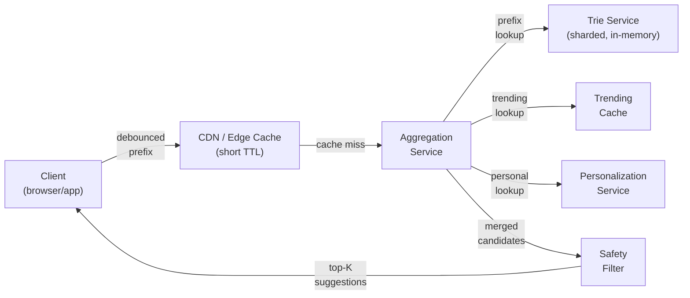
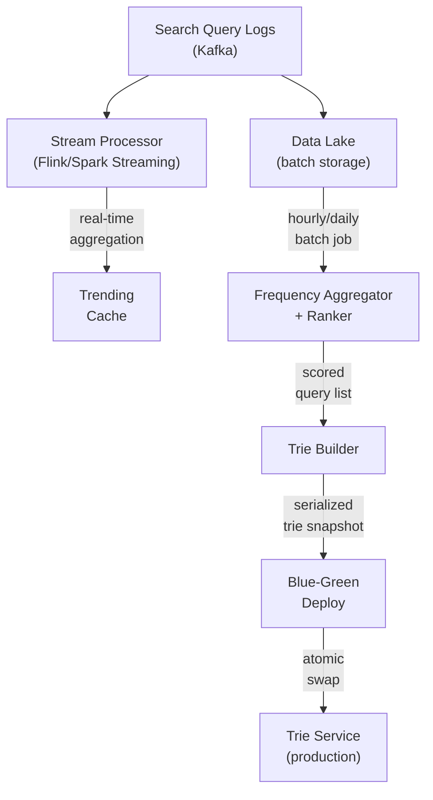

# Designing a Search Autocomplete System

## 1. Overview and Goals

A search autocomplete (typeahead) system predicts what a user is trying to search for as they type, returning a ranked list of suggestion completions after every keystroke — the dropdown of predictions that appears below Google's search box before anyone presses Enter. The defining characteristic that shapes most of this design is the extreme latency sensitivity: suggestions must appear fast enough that they feel like they're already there when the user looks, which means the system has to return results *between keystrokes* — roughly every 50–200ms of human typing speed. A suggestion that arrives after the user has already typed two more characters is a suggestion nobody sees.

This is fundamentally a read-heavy, latency-critical system. The write side (collecting queries, recomputing rankings, rebuilding the index) is large in volume but entirely offline — nothing on the write path sits between a keystroke and its suggestions. That asymmetry — offline writes, real-time reads — is the single most important architectural fact in this design and shapes almost every decision that follows.

**Functional requirements:**

- As a user types each character in a search box, the system returns a ranked list of the top-K (typically 5–10) suggested query completions matching the typed prefix.
- Suggestions reflect what real users actually search for: popular queries, trending queries, and (optionally) the current user's own search history.
- Suggestions update with every keystroke — typing "san f" shows San Francisco predictions; adding an "e" to get "san fe" shifts to San Fernando predictions instead.
- Offensive, harmful, or policy-violating predictions are filtered out before they reach the user.
- The system handles multiple languages and locales, with suggestions relevant to the user's region.

**Non-functional requirements:**

- **Ultra-low latency**: suggestions must arrive within 100ms server-side (p99), so the user perceives them as instant. This is tighter than most systems — a feed can tolerate 500ms; autocomplete cannot, because each extra keystroke renders stale suggestions useless.
- **High availability**: autocomplete failing silently (returning nothing) is acceptable as a degradation; autocomplete failing loudly (error, delay, flicker) is not. The system should be available 99.99%+ of the time.
- **Massive read throughput**: with hundreds of millions of users typing queries, and each query generating multiple keystroke-level requests, read QPS is in the hundreds of thousands to low millions.
- **Freshness for trends**: a breaking news event or a viral moment should surface in suggestions within minutes, not hours — but the base index of stable, popular queries can be rebuilt on a slower cadence (hourly or daily).
- **Scale**: the system indexes hundreds of millions of distinct queries across multiple languages and regions.

These requirements pull in a specific direction: the read path must be as close to a pure lookup as possible — no ranking, no filtering, no aggregation at query time. Everything expensive happens offline, and the online path just retrieves precomputed results.

## 2. Basic Data Model

```
Query Record (in the analytics/aggregation layer, not the serving layer):
  <query_text, language, region, frequency_count, last_seen_at,
   click_through_rate, success_rate>

Trie Node (in the serving layer):
  <prefix, children[], is_terminal,
   top_k_suggestions[]: list of {query_text, score}>

Suggestion:
  <query_text, display_text, score, category: {popular, trending, personal},
   metadata: {region, language}>

Trending Entry:
  <query_text, language, region, trend_velocity, window_start, window_end,
   current_count, baseline_count>

User Search History (for personalization):
  <user_id, query_text, searched_at, clicked_result_url>

Blocklist Entry:
  <pattern, reason, added_by, added_at, scope: {exact, prefix, regex}>
```

**Why the serving data model is a trie node with precomputed top-K, not a query record.** The serving layer never looks at raw query records at request time — it only reads precomputed suggestions already attached to each prefix node. This is the key insight separating autocomplete from a general search problem: the "search" has already happened, offline, when the trie was built. At query time, the system just walks the trie to the node matching the typed prefix and returns whatever top-K list is already sitting there. No sorting, no filtering, no aggregation — O(prefix length) to walk, O(1) to read the answer. The raw query records, frequency counts, and click-through data exist only in the offline pipeline that *produces* the trie; they never appear on the serving path.

**Why personal history is separated.** Mixing per-user search history into the global trie would mean either building a separate trie per user (hundreds of millions of tries — absurd) or polluting the global trie with everyone's individual queries. Instead, personal suggestions are handled as a thin overlay: a small, per-user recent-query list stored separately (a simple key-value lookup by user ID), merged with the global top-K at the aggregation layer before results are returned. This keeps the global trie clean and the personalization layer independently scalable.

## 3. High-Level Architecture

### 3.1 Online Serving Path (Read Path)



**What each component does, briefly:**

- **Client**: debounces keystrokes (typically 100–200ms) so that rapid typing doesn't fire a request per character, and caches recent prefix results locally so that backspace reuses them.
- **CDN / Edge Cache**: caches the most popular prefix results (short TTL, 5–15 minutes) geographically close to the user. At ~95% cache-hit rate for common prefixes, this absorbs the vast majority of traffic before it ever reaches the backend.
- **Aggregation Service**: the thin orchestrator — fetches candidates from the global trie, the trending cache, and the personalization service in parallel, merges them into one ranked list, and passes them through the safety filter. This is stateless and horizontally scaled.
- **Trie Service**: the core serving index — an in-memory, sharded trie with precomputed top-K suggestions at each node. The entire read path for a single prefix is a pointer walk + a list read — microseconds, not milliseconds.
- **Trending Cache**: a small, separately-maintained index of queries currently spiking, refreshed every 1–5 minutes from the streaming pipeline. Kept separate from the main trie because it changes too fast for the main trie's rebuild cadence.
- **Personalization Service**: looks up the user's recent/frequent searches and returns any that match the current prefix. A key-value store keyed by user ID, not a trie.
- **Safety Filter**: checks merged candidates against a blocklist (exact match, prefix match, regex patterns) and a lightweight ML classifier for policy-violating content. Runs after merge, before response.

### 3.2 Offline Data Pipeline (Write Path)



**What each component does:**

- **Search Query Logs**: every executed search (not every keystroke — only completed, submitted queries) is logged with timestamp, user ID (hashed for privacy), region, language, and the result the user clicked on. These flow into Kafka for both real-time and batch consumption.
- **Stream Processor**: consumes the log stream in real time, maintaining sliding-window counters for query frequency. Its job is detecting *trends* — queries whose current rate significantly exceeds their historical baseline — and pushing those into the Trending Cache within minutes.
- **Data Lake**: the durable, batch-accessible store of all query logs. The batch pipeline reads from here, not from the live stream.
- **Frequency Aggregator + Ranker**: a batch job (hourly or daily) that computes per-query scores from frequency, recency (exponential decay), click-through rate, and success rate, producing a scored, ranked list of all queries worth suggesting.
- **Trie Builder**: takes the scored query list, constructs a compressed trie (radix tree) with the top-K suggestions precomputed at every prefix node, serializes it into a compact binary format, and publishes the snapshot.
- **Blue-Green Deploy**: trie snapshots are deployed by swapping — new trie servers load the fresh snapshot and are health-checked before traffic shifts to them, so the cutover is atomic with zero downtime. The old version stays available for instant rollback.

## 4. The Trie — Deep Dive

**Why a trie, not a database or an inverted index.** The access pattern for autocomplete is always the same: "given this prefix, give me the best completions." A trie is the only data structure where this operation is a single pointer walk proportional to the prefix length, followed by reading a precomputed list — no hash collisions, no disk seeks, no index traversal. An inverted index (Elasticsearch, for instance) can answer prefix queries too, but with 10–30ms latency per query versus 1–5ms for an in-memory trie — acceptable for many applications, but autocomplete's sub-100ms p99 budget (which includes network round-trips, CDN misses, and aggregation) leaves very little room for the index lookup itself. A relational database is even further from the performance needed.

**Why a compressed trie (radix tree), not a plain trie.** A standard trie creates one node per character, which means long query strings with unique prefixes generate long chains of single-child nodes — wasted memory and wasted pointer chasing. A radix tree merges these chains: if the only completion of "algor" is "algorithm," the path from "algor" to "algorithm" is stored as a single edge labeled "ithm," not five separate nodes. For a corpus of 100 million distinct queries, this compression typically reduces memory usage by 3–5× compared to a naive character-per-node trie, bringing it from an estimated 50+ GB down to 10–15 GB — comfortably within a single server's RAM, and small enough to replicate across many servers.

**Precomputed top-K at every node.** This is the design decision that makes the online path O(prefix length) instead of O(all completions under this prefix). When the trie is built offline, the builder propagates suggestions upward: each node stores the top-K (say, K=15, a superset of the 5–10 shown to the user, to leave room for filtering) highest-scored completions from its entire subtree. At query time, the trie service walks to the node matching the typed prefix and reads the list directly — no traversal of the subtree, no sorting, no aggregation. The cost is higher memory (each node carries a list of K suggestions, not just a single score), but this is a deliberate trade of offline build cost and memory for online latency.

**Worked example.** Consider a trie containing these scored queries:

| Query | Score |
|---|---|
| "san francisco restaurants" | 920 |
| "san francisco weather" | 880 |
| "san fernando valley" | 640 |
| "sandwich recipes" | 560 |
| "santa monica beach" | 510 |

When the user types "san f", the trie service walks: root → "s" → "a" → "n" → " " → "f". At the node for "san f", the precomputed top-5 list contains all five entries above (all share the prefix "san f"... actually "san fernando" and "san francisco" do, while "sandwich" and "santa" do not — they branched off at "san" before the space+f). So the node for "san f" stores:

1. "san francisco restaurants" (920)
2. "san francisco weather" (880)
3. "san fernando valley" (640)

And the node for "san" (one level up, before the user typed the space and "f") stores all five, since "sandwich" and "santa" also match "san". When the user adds "e" to get "san fe", the walk continues to "san fe", whose top-K contains only "san fernando valley" — the San Francisco entries no longer match. The shift in suggestions the user sees is just the trie service reading from a different node, not recomputing anything.

**Node structure in practice.** Each node in the serialized trie looks roughly like:

```
TrieNode:
  edge_label: string            # the label on the edge FROM this node's parent TO this node
  children: map<char, TrieNode*> # key = first char of child's edge_label → child node
  is_terminal: bool              # true if this node represents a complete query
  top_k: [{query, score}]       # precomputed, sorted by score descending
```

The `children` map is keyed by the *first character of the child's edge label*, not the full edge — this is how the trie walk decides which branch to take at each step. Children are stored as a hash map or sorted array of (character → pointer) pairs, not a fixed 26-slot or 256-slot array — since most nodes have only a few children (especially deep in the tree), a fixed array would waste most of its slots. The top-K list is stored inline, sorted by score descending, so returning the answer is just slicing the first N entries.

**Concrete example.** A radix tree containing "algorithm" (500), "algebra" (400), and "alpha" (300):

```
(root)
  └─ "al" ──→ Node A
                ├─ "g" ──→ Node E
                │           ├─ "orithm" ──→ Node B [terminal: "algorithm", 500]
                │           └─ "ebra"   ──→ Node C [terminal: "algebra", 400]
                └─ "pha" ──→ Node D [terminal: "alpha", 300]
```

Each node's fields:

| Node | edge_label | children | is_terminal | top_k |
|---|---|---|---|---|
| root | (none) | {'a' → A} | false | [("algorithm",500), ("algebra",400), ("alpha",300)] |
| A | "al" | {'g' → E, 'p' → D} | false | [("algorithm",500), ("algebra",400), ("alpha",300)] |
| E | "g" | {'o' → B, 'e' → C} | false | [("algorithm",500), ("algebra",400)] |
| B | "orithm" | {} | true | [("algorithm",500)] |
| C | "ebra" | {} | true | [("algebra",400)] |
| D | "pha" | {} | true | [("alpha",300)] |

**How a lookup walks this.** A query for prefix "alg": root looks up 'a' in children → Node A, consume "al" from the prefix, remaining prefix is "g", look up 'g' in Node A's children → Node E, consume "g", prefix fully consumed → read Node E's `top_k` → return [("algorithm", 500), ("algebra", 400)]. The entire walk touched three nodes and read one precomputed list — no subtree traversal, no sorting.

## 5. Sharding the Trie — Deep Dive

**Why shard at all when it fits on one machine.** A 10–15 GB radix tree fits comfortably in a single server's memory. But fitting in memory and being able to serve the traffic are different problems. At peak, hundreds of thousands of prefix lookups per second hit the trie service (after CDN and edge caching absorb the common prefixes). A single server, even with the lookup itself taking microseconds, would hit CPU and network limits well before it hits memory limits. Sharding spreads the load across machines; replication within each shard adds redundancy.

**Why not shard alphabetically.** The naive approach — shard A on server 1, B on server 2, and so on — creates extreme imbalance. Queries starting with "s" and "c" are far more common than queries starting with "x" or "z" in English. One shard would be saturated while another sits idle. This imbalance gets worse, not better, as traffic grows.

**Range-based sharding with traffic-aware splits.** The approach that works is to partition the prefix space by measured traffic, not by alphabet position. The trie builder, which already knows every query's frequency, assigns prefix ranges to shards such that each shard handles roughly equal traffic volume. For example:

| Shard | Prefix Range | Approx. Traffic Share |
|---|---|---|
| 1 | a – ca | ~12% |
| 2 | cb – di | ~12% |
| 3 | dj – g | ~13% |
| 4 | h – m | ~13% |
| 5 | n – sa | ~12% |
| 6 | sb – th | ~13% |
| 7 | ti – z | ~12% |

The ranges are recomputed with each trie rebuild, so a trending topic that suddenly makes "t" queries spike gets rebalanced on the next build cycle, not left as a permanent hot spot. A routing layer (a thin proxy or the aggregation service itself) maps each incoming prefix to its shard, using a small in-memory routing table that's updated atomically whenever the shard assignment changes.

**Replication within each shard.** Each shard runs as multiple replicas (typically 3+), with reads load-balanced across them. Since the trie is read-only between rebuilds, all replicas serve identical data — there's no consistency problem, no leader/follower divergence. A failed replica is just removed from the load-balancer pool; the remaining replicas absorb its traffic until a replacement loads the current snapshot.

## 6. The Aggregation Service — Deep Dive

The aggregation service is the central orchestrator of the read path — the one stateless component that every CDN-miss request passes through — and despite being called "thin" in §3, it does more work than any other single component on a per-request basis. It deserves its own section because the merge logic, timeout handling, and degradation behavior are where most of the real read-path complexity lives.

**What it does, step by step.** On every request, the aggregation service:

1. **Parses the request**: extracts the prefix, the user's region/language (from headers or a geo-IP lookup), and the user's identity (from an auth token, if present — unauthenticated requests skip personalization).
2. **Fans out three parallel lookups**: it sends the prefix simultaneously to the trie service (the correct shard, determined by the in-memory routing table from §5), the trending cache, and the personalization service (only for authenticated requests). These are independent, non-blocking calls — the service doesn't wait for one to finish before starting the next.
3. **Collects results with a timeout budget**: all three lookups must complete within a strict timeout (e.g., 50ms). If the trie service responds in 3ms but the personalization service hasn't responded by 50ms, the aggregation service proceeds with what it has — global + trending, no personal results. This is the graceful-degradation contract: any single backend being slow or unavailable degrades the result quality, never the response latency or availability.
4. **Merges candidates into one ranked list**: the merge is a priority-queue merge of up to three sorted lists. Duplicates (the same query appearing in both global and trending, or both global and personal) are deduplicated, keeping the highest score. Personal results get their additive boost applied at this point (§9). The merged list is sorted by final score descending.
5. **Passes the merged list through the safety filter** (§10): candidates that match the blocklist or trigger the ML classifier are removed.
6. **Slices to the final top-N** (typically 5–10) and returns the response.

**Why the timeout budget is the most important number in this design.** The end-to-end p99 budget from §1 is 100ms. The CDN-miss path includes: network from CDN to aggregation service (~5–15ms depending on geography), the aggregation service's own work, and network back to the CDN (~5–15ms). That leaves roughly 70–90ms for the aggregation service to do everything — fan out, collect, merge, filter, respond. Since the trie lookup itself takes 1–5ms and the trending cache is similarly fast, the 50ms timeout is generous for the common case but tight enough to cut off a slow personalization lookup before it blows the budget. The service tracks timeout-triggered degradations as a metric (§15) so that a backend that's chronically slow gets flagged rather than silently degraded away.

**Partial failure handling.** Each of the three backends can fail independently, and the aggregation service handles each case:

| Backend down | Impact | Behavior |
|---|---|---|
| Trie service (the shard for this prefix) | No global results — critical | Return trending + personal only if available; if those are also empty, return empty result (the client shows nothing). This is rare because each shard has 3+ replicas. |
| Trending cache | No trending results — minor | Return global + personal. Most requests don't have trending matches anyway. |
| Personalization service | No personal results — minor | Return global + trending. Identical to the unauthenticated experience. |
| All three | No results at all | Return empty. The client shows no suggestions. This is an availability incident, not a design gap. |

**Statelessness and horizontal scaling.** The aggregation service holds no per-request state between calls — every request is self-contained. It does hold a small amount of *configuration* state in memory: the shard routing table (which prefix range maps to which trie shard), the blocklist (for the safety filter's deterministic layer), and optionally a local results cache (§12's aggregation-layer cache, keyed by prefix+region, TTL 1–5 minutes). None of this is per-user or per-request, so every instance is interchangeable and the fleet scales horizontally behind a load balancer with no affinity requirements.

**Worked example.** User types "elec" from the US, authenticated:

1. Routing table says "elec" falls in shard 3 (prefix range dj–g). Fan out:
   - Trie shard 3: returns `[("election results 2026", 940), ("electric car", 870), ("electricity bill pay", 820), ("electric guitar", 790), ("electronic", 750)]` in 2ms.
   - Trending cache: returns `[("election results 2026", trend_velocity=high)]` in 1ms.
   - Personalization service: returns `[("electric car charger near me", personal_boost=+200)]` in 8ms.
2. Merge: "election results 2026" appears in both global and trending — keep global score (940) plus a trend boost. "electric car charger near me" from personal gets base score 0 (not in global top-K) + 200 personal boost = 200, which inserts it below the global results. Deduplicated, re-sorted:
   - "election results 2026" (940 + trend boost)
   - "electric car" (870)
   - "electricity bill pay" (820)
   - "electric guitar" (790)
   - "electronic" (750)
   - "electric car charger near me" (200)
3. Safety filter: all pass.
4. Slice to top-5, return to client. The personal result didn't make the cut this time — the global competition was too strong. If the user had typed "electric car ch" (a longer, more specific prefix), the personal result would rank higher because fewer global results match.

## 7. The Offline Pipeline — Deep Dive

### 7.1 The Log Pipeline (Kafka) — Deep Dive

**What Kafka is doing here and why it's the right tool.** Every completed search event needs to reach two independent consumers: the stream processor (for real-time trend detection) and the data lake (for batch aggregation). Kafka's publish-subscribe model with independent consumer groups means each consumer reads the same stream at its own pace — the stream processor consumes events within seconds of their arrival, while the data lake consumer can batch-write in larger chunks — without either one blocking or falling behind the other. A direct database write from the search service would couple the search latency to the write latency of the analytics store; Kafka decouples them by absorbing the burst and letting consumers pull at their own rate.

**Topic and partition design.** Search events are published to a single Kafka topic (e.g., `search-events`), partitioned by a hash of the region + language pair. This means all searches from the same locale land in the same partition, which matters for two reasons: the stream processor's sliding-window counters (§7.2) are per-query-per-region, so co-locating events by region means each Flink task can maintain its counters locally without cross-partition shuffles for the common case; and the batch consumer can process each partition independently when building per-region scored lists, without a global sort. The number of partitions is set high enough (e.g., 64–256) to parallelize consumption across many consumer instances, and each partition is replicated across 3 Kafka brokers for durability — a broker failure loses no events because the replicas take over automatically.

**Retention.** Kafka retains events for a configurable window (e.g., 7 days), long enough for the batch pipeline to reprocess a full week of data if a pipeline bug is discovered and the scored list needs to be rebuilt from scratch. After the retention window, events are only in the data lake, not in Kafka.

**Backpressure.** If the stream processor falls behind (a Flink restart, a slow checkpoint), Kafka simply buffers — its on-disk log grows, and the consumer picks up where it left off once it recovers. The search service is never slowed down or blocked because Kafka is the shock absorber between the write rate (hundreds of thousands of events/second at peak) and the consumer rate.

### 7.2 The Stream Processor (Flink) — Deep Dive

**What it maintains in memory.** The stream processor's core state is a set of sliding-window counters: for each `(query_text, region)` pair, it maintains the count of search events in the last 1 minute, 5 minutes, and 1 hour. These windows are implemented as Flink's built-in event-time tumbling or sliding windows, backed by Flink's state backend (RocksDB for large state, heap for smaller deployments). The windows are keyed by `(query_text, region)`, meaning each Flink task (parallel instance) handles a subset of the key space and maintains only its own counters — no cross-task coordination for the counting itself.

**Late-arriving events.** Event-time processing means Flink uses the timestamp embedded in each search event, not the wall-clock time it arrives at the processor. Events that arrive late (delayed by network, Kafka consumer lag, etc.) are handled via Flink's watermark mechanism: Flink allows events up to a configured lateness (e.g., 30 seconds) to be incorporated into the window they belong to, even if that window has technically closed. Events arriving later than the allowed lateness are dropped — they're too old to affect trend detection, and the batch pipeline will count them correctly anyway. This is a deliberate tradeoff: trend detection cares about *right now*, not about perfect historical accuracy.

**Trend detection logic.** Every time a window closes (e.g., every minute for the 1-minute window), Flink compares the new count against the historical baseline loaded from the batch pipeline's most recent output. The comparison produces the trend velocity described in §7's top-level section: `(current_rate - baseline_rate) × log(1 + current_rate)`. Queries exceeding the threshold are emitted as trend events to the trending cache. Queries that were trending but have dropped back below the threshold are emitted as expiry events, proactively removing them from the trending cache rather than waiting for the TTL.

**Checkpointing and restart.** Flink periodically checkpoints its entire state (all window counters) to durable storage (e.g., S3 or HDFS). If a Flink task crashes, it restarts from the last checkpoint, replays events from Kafka starting at the checkpoint's offset, and reconstructs its windows. The gap between the last checkpoint and the crash means some events are replayed (counted twice), but since the counters are being compared against baselines via ratios, not used as exact counts, a brief double-count doesn't cause false trends — it would need to be a sustained, large-scale double-count to push a query past the 5–10× threshold, which is extremely unlikely for the few seconds of replay involved.

**Scaling.** The number of Flink tasks scales with the number of Kafka partitions — each task consumes one or more partitions, and adding more tasks (up to the partition count) increases parallelism linearly. The state size per task is bounded because the window duration is short (1 hour max) and the key space per partition is a subset of the total queries, so each task holds at most a few GB of state — well within a single JVM's capacity.

### 7.3 The Data Lake — Deep Dive

**What it stores and how.** The data lake is the durable, long-term store of all search events — the batch pipeline's source of truth. Events are written by a Kafka consumer (a separate consumer group from the stream processor) in micro-batches, appended to partitioned files organized by `date/region/language` (e.g., `s3://search-events/dt=2026-10-11/region=us/lang=en/part-00042.parquet`). The file format is Parquet (columnar, compressed), chosen because the batch pipeline's aggregation queries — "count searches for each query in region X over the last 30 days" — read only the `query_text` and `timestamp` columns across many files, and columnar storage makes that far cheaper than scanning full rows. Compression (Snappy or ZSTD) reduces the ~500 GB/day raw event volume to roughly 100–150 GB/day on disk.

**Retention and lifecycle.** Raw events are retained for 90 days — long enough to recompute the full 30-day rolling window from scratch at any point, plus margin for debugging and auditing. After 90 days, raw events are deleted; only the aggregated per-query statistics survive (in the batch pipeline's output tables). This retention policy is also the privacy boundary: no user's individual search history exists in the data lake beyond 90 days, even in pseudonymized form.

**How the batch pipeline reads it.** The frequency aggregator (§7.5) runs as a Spark or Presto job that scans the last 30 days of Parquet files, grouped by `(query_text, region, language)`, computing the signals described in §7.5 (frequency, recency-weighted count, CTR). Because the files are partitioned by date and region, the job reads only the partitions it needs — a regional trie rebuild for the US only reads `region=us` partitions, skipping all other regions entirely. This partition pruning is what makes a daily scan of 30 × 500 GB = 15 TB of raw data tractable: the actual read volume for a single-region rebuild is closer to 500 GB.

### 7.4 Data Collection

**What gets logged and what doesn't.** Every *completed* search — a query the user actually submitted, not the intermediate keystrokes that generated autocomplete requests — is logged as a structured event: `{query_text, timestamp, user_id_hash, region, language, device_type, clicked_result_url, result_position_clicked}`. Intermediate keystrokes are *not* logged for autocomplete purposes — they'd multiply log volume by 5–10× while adding mostly noise (partial, abandoned prefixes the user never intended as queries). Click data matters because a query that gets submitted but whose results are never clicked is a weaker signal than one where the user clicks the first result — it suggests the query was either poorly formed or the results were unhelpful, both of which should dampen its suggestion score.

**Data sampling.** At very high scale (billions of searches per day), logging every single completed search is itself expensive — the data lake grows by hundreds of GB daily, and the batch aggregation job scans all of it. A common optimization is to log only a sample: say, 1 in 10 searches (or 1 in 100 for extremely high-traffic prefixes). Since the scoring pipeline computes *relative* popularity (query A is more popular than query B), a uniform sample produces the same ranking as the full log, just with noisier counts — and the noise washes out for any query popular enough to be worth suggesting. The trade-off is that very rare queries (those searched only a handful of times in a sample window) may not appear in the sample at all, which means they never enter the trie. For autocomplete this is fine: a query too rare to survive sampling is too rare to be a useful suggestion.

**Privacy considerations.** User IDs are hashed before entering the log pipeline, and personal search history is subject to retention limits (e.g., 90 days) and user-initiated deletion. Aggregate query statistics (frequency, CTR) are anonymized — once a query has been counted, the individual who searched for it is no longer identifiable from the aggregate. This separation is important because the trie itself must never contain data that could be traced back to an individual user; it stores only query text and a score derived from anonymous aggregates.

### 7.5 Frequency Aggregation and Scoring

The batch pipeline runs hourly or daily and produces a single artifact: a scored, ranked list of all queries that should appear as suggestions. The score for each query combines several signals:

**Popularity (frequency).** The dominant signal — how many times this query has been searched. Raw counts are log-scaled (`log(1 + count)`) to prevent extremely popular queries from drowning out everything else: a query searched 10 million times shouldn't score 1,000× higher than one searched 10,000 times — both are clearly popular. The frequency is computed over a rolling window (e.g., the last 30 days), not all-time, so queries that were popular a year ago but are now irrelevant gradually fade out.

**Recency (exponential decay).** Within the rolling window, more recent searches count more than older ones. An exponential decay function (`e^(-λ × age_in_days)`) ensures that a query searched heavily yesterday scores higher than one searched heavily three weeks ago, even if their total counts are similar. The decay rate (λ) is tunable — faster decay makes the system more responsive to trends but also more volatile.

**Click-through rate.** A query with high search frequency but low CTR — people search for it but don't click on any results — is a weaker suggestion than one where users consistently find what they're looking for. CTR acts as a quality signal, not a primary ranking factor: it adjusts scores at the margin, not dominantly.

**Regional and language weighting.** A query popular in India but rare in the US should appear in suggestions for Indian users but not American ones. The scoring pipeline produces per-region, per-language variants of the scored list, so the trie builder can construct region-specific tries (or region-specific top-K lists within a shared trie structure).

**The combined score** is a weighted sum, with weights tuned via offline experimentation:

```
score = w_pop × log(1 + frequency)
      + w_rec × recency_decay
      + w_ctr × click_through_rate
      + w_trend × trend_boost
```

Typical starting weights might be `w_pop=0.5, w_rec=0.2, w_ctr=0.1, w_trend=0.2`, but these are tuned against a held-out evaluation set measuring suggestion quality (how often users select a suggested completion versus typing their own query in full).

### 7.6 Trie Build — Deep Dive

**Building the trie, step by step.** The trie builder takes the scored query list and:

1. **Insertion with inline compression**: inserts each query into a radix tree, compressing as it goes — not as a separate pass afterward. When a new query shares a prefix with an existing edge, the insert operation splits that edge at the divergence point immediately. For example, if "algorithm" is already in the tree as a single edge from the root, inserting "algebra" splits the "alg" prefix into a shared node right then, with "orithm" and "ebra" as two child edges. No single-child chain is ever created only to be compressed away later; every node that gets allocated is already in its final, compressed form. This matters because building a full character-per-node trie first and then compressing it in a second pass would mean allocating millions of intermediate nodes that are immediately discarded — wasted memory and wasted time for a structure that can easily hold 100 million queries.
2. **Why this is a radix tree from the start, not a trie that becomes one**: the distinction matters for the build cost. A naive trie stores one node per character, so "algorithm" is 9 nodes. A radix tree stores it as one edge. If the builder created a naive trie first and then merged chains, the peak memory during the build would be the full uncompressed trie size (50+ GB for 100 million queries) even though the final output is only 10–15 GB. By splitting edges inline during insertion, the builder's peak memory is close to the final output size — the compressed radix tree is the only structure that ever exists.
3. **Score attachment**: at each terminal node (a node where a complete query ends), the builder stores that query's final score from §7.5.
4. **Bottom-up top-K propagation**: starting from the leaves and working upward to the root, each node computes its top-K list by merging its own terminal entry (if any) with the top-K lists of all its children, keeping only the K highest-scored entries. This is a single post-order traversal of the tree — each node is visited exactly once, and the work at each node is O(K × number_of_children), bounded because K is small (10–15) and most nodes have few children. The result: every node in the tree, from root to leaves, carries its own precomputed answer to "what are the best completions under this prefix?"
5. **Serialization**: the tree is serialized into a compact binary format — a flat byte array where each node is a fixed-size header (edge label length, child count, top-K count) followed by its variable-length data (edge label bytes, child offsets as byte positions in the array rather than heap pointers, top-K entries). This layout means the serving process can memory-map the file directly from disk into its address space and serve queries immediately — no deserialization step, no object allocation, no GC pressure. The trie is literally a file that happens to also be a usable in-memory data structure.

**Build cost.** For 100 million queries averaging 30 characters, the build takes minutes on a single machine with sufficient RAM (16–32 GB). The bottom-up propagation is the most expensive step (it touches every node), but it's a single linear pass. The serialization step writes 10–15 GB to disk. The entire build is embarrassingly restartable — if it fails partway through, rerunning it on the same input produces the same output, with no cleanup needed.

**Persistent storage: binary snapshot vs. flattened key-value store.** The serialized binary format described above is one approach to persisting the trie between builds. An alternative, worth knowing, is to flatten the trie into a key-value store — each prefix in the trie becomes a key, and the value is that prefix's top-K list. For example, `"al" → [("algorithm", 500), ("algebra", 400), ("alpha", 300)]`. At serving time, a prefix lookup becomes a single key-value fetch rather than a trie walk. This trades the trie's compact, pointer-based structure for the operational simplicity of an existing KV store (Redis, DynamoDB, etc.) — no custom binary format to maintain, no memory-mapping, and the store handles replication and failover. The downside is that it duplicates data massively: every prefix in the tree gets its own stored list, including short prefixes like "a" whose top-K list is identical to the top-K list of the root node's 'a' child. For 100 million queries, this can produce hundreds of millions of key-value pairs. The binary-snapshot approach avoids this duplication by storing the tree structure once, but at the cost of needing custom serialization and a memory-mapped serving layer. Both are valid choices; this design uses the binary snapshot for its compactness and sub-microsecond lookup latency, but the KV-store approach is a reasonable alternative for smaller corpora or teams that prefer operational simplicity over raw performance.

**Update strategies: full replacement vs. in-place node mutation.** This design replaces the entire trie on each build cycle (§7.7). The alternative — updating individual nodes in the live trie (incrementing a query's score, re-sorting a node's top-K list, propagating changes upward) — seems more efficient but creates real problems at scale: the trie is being read by thousands of concurrent requests per second, so in-place updates require either locking (which kills read latency) or a lock-free copy-on-write scheme (which adds significant implementation complexity for a structure this large). Propagating a score change upward — a single query's score changing requires re-sorting the top-K list of every ancestor node — is O(depth × K) per update, and at tens of thousands of score changes per hour, this adds up to continuous background churn. Full replacement avoids all of this: the new trie is built cleanly offline, the old one keeps serving without any mutation, and the swap is atomic. The only cost is building the full trie from scratch each time — minutes of compute on a single machine, which is trivial compared to the complexity of making in-place updates safe under concurrent reads.

### 7.7 Blue-Green Deployment — Deep Dive

**Why deployment is its own concern.** Swapping a 10–15 GB in-memory data structure across a fleet of servers without dropping a single request or serving inconsistent results (some users getting old-trie results while others get new-trie results from the same prefix) is not trivial. The deployment mechanism is as much a part of the system's reliability as the trie itself.

**The deployment sequence, in full:**

1. **Build and publish**: the trie builder (§7.6) produces a versioned snapshot file (e.g., `trie-v20261011-0600.bin`) and writes it to a shared object store (S3, GCS). The version includes the build timestamp and a checksum.
2. **Standby fleet load**: a standby set of trie servers (the "green" fleet, identical in size to the production "blue" fleet) downloads the snapshot and memory-maps it. Each server reports ready once the snapshot is loaded and its health check passes (basic: can it answer a known query correctly? latency: is its p99 under threshold?).
3. **Canary validation**: before any traffic shifts, a canary process runs a suite of ~10,000 known-good (prefix, expected_top_result) pairs against the green fleet. If the canary detects regressions — a top result that disappeared, a blocked query that's now appearing, a latency spike — the deploy is aborted and an alert fires. This catches trie-build bugs (a scoring error, a corrupted serialization) before they reach any real user.
4. **Traffic shift**: the routing layer (the aggregation service's shard routing table, or the load balancer in front of the trie fleet) atomically redirects all traffic for all shards from the blue fleet to the green fleet. "Atomically" here means per-request, not per-connection — a request in flight to the blue fleet finishes there; the next request goes to the green fleet. There's no window where some shards serve old data and others serve new data, because the routing table update is a single atomic swap of the entire shard map.
5. **Bake period**: the blue fleet stays running (with no traffic) for a bake period (e.g., 30 minutes). If monitoring detects a quality or latency regression in the green fleet during this window, a single routing-table rollback sends all traffic back to the blue fleet — the rollback is the same atomic swap, in the other direction.
6. **Teardown**: after the bake period passes cleanly, the blue fleet is torn down (or recycled as the next deploy's standby).

**Why not in-place reload?** An alternative to blue-green is having each trie server download the new snapshot and swap its in-memory trie in place (e.g., build the new trie in a background thread, then swap an atomic pointer). This is simpler and cheaper (no standby fleet), but it has a real problem: during the reload, each server is briefly serving from a partially-loaded or transitioning state, and if the reload fails (OOM, corrupted file), the server is down until it's restarted with the old snapshot. Blue-green avoids both issues — the swap is instant and the old fleet is always available for rollback.

**Build cadence.** The full rebuild runs daily for the base index (stable, popular queries that don't change much day to day). An hourly incremental build can produce a "patch" — a smaller trie of queries whose scores have changed significantly since the last full build — that gets merged at query time by the aggregation service alongside the main trie. This gives a good balance between freshness and build cost.

## 8. Trending Queries — Deep Dive

**Why trends can't wait for the batch rebuild.** When a major news event breaks, millions of people start searching for it within minutes. If the only way to surface that query as a suggestion is to wait for the next daily (or even hourly) trie rebuild, the system fails at exactly the moment it would be most useful — the moment when users most need help completing an unfamiliar query they've never typed before. Trends need a separate, much faster path.

**How trend detection works.** A stream processor (Flink, Spark Structured Streaming, or similar) consumes the same Kafka query-log stream that feeds the batch pipeline, but maintains *sliding-window counters* — the count of each query over the last 1 minute, 5 minutes, and 1 hour. A query is flagged as trending when its current rate significantly exceeds its historical baseline: specifically, when `current_rate / baseline_rate > threshold` (a typical threshold might be 5–10×, tuned to avoid surfacing noise as trends). The baseline comes from the batch pipeline's most recent frequency data.

**The trend velocity signal.** Not all spikes are equal. A query going from 10 searches/hour to 100 searches/hour (10× spike from a low base) is less interesting than one going from 10,000/hour to 100,000/hour (10× spike from a high base). The trend velocity — `(current_rate - baseline_rate) × log(1 + current_rate)` — captures both the spike ratio and the absolute volume, so that genuine mass-interest events rank above niche flukes.

**The trending cache.** Detected trends are written to a small, fast-updating cache (e.g., Redis or an in-memory store on the aggregation service itself), keyed by prefix and region. This cache is tiny compared to the main trie — typically a few thousand entries at most, since only a small fraction of queries are trending at any given moment. The aggregation service queries this cache alongside the main trie on every request and merges any matching trending entries into the candidate set before final ranking.

**TTL and decay.** Trending entries aren't permanent — they carry a TTL (e.g., 2–4 hours) and are evicted automatically if their velocity drops below the threshold. A trend that sustains will eventually be picked up by the next batch rebuild and incorporated into the main trie at its earned score, at which point the trending cache entry is no longer needed. This means the trending cache is self-cleaning: it handles the fast ramp-up, the main trie absorbs sustained popularity, and the cache drains naturally in between.

## 9. Personalization — Deep Dive

**What personalization means for autocomplete, concretely.** If a user has searched for "python tutorial" five times in the last week, then when they type "py," "python tutorial" should rank higher in their suggestions than it would for a random user — even if the globally most popular "py" completion is "pypl stock price." This doesn't mean replacing the global suggestions entirely; it means boosting a few of the user's own frequent/recent queries into the top-K alongside the global results.

**Architecture: a thin overlay, not a per-user trie.** The personalization service stores a bounded list of each user's recent searches — say, the last 100, subject to a retention policy (90 days). This is a simple key-value store keyed by `user_id`: no trie, no complex index, just a list of `{query_text, searched_at, count}` entries per user. At query time, the aggregation service sends the current prefix to this service, which scans the user's list for prefix matches and returns any hits with a personalization boost score. This scan is fast because the list is small (≤100 entries), and the lookup is a single key-value fetch by user ID.

**Merging personal and global results.** The aggregation service receives candidates from three sources: global trie (top-K), trending cache (0–few entries), and personalization service (0–few entries). It merges them by score, with the personalization boost applied additively — a personal result gets a fixed score bonus that's large enough to push it into the top-5 if the global competition isn't too strong, but not so large that a query the user searched once six weeks ago outranks the globally #1 suggestion. The exact bonus is tunable and typically set conservatively: personalization should feel helpful, not creepy.

**Privacy constraint.** Personal suggestions are never shown to anyone but the authenticated user — no personal queries leak into the global trie, the CDN cache, or another user's results. The aggregation service only calls the personalization service for authenticated requests, and CDN-cached results (which are shared across users) never include personal suggestions. This means a CDN cache hit skips personalization entirely, which is the right trade-off: the most popular prefixes (which are the ones the CDN caches) benefit least from personalization anyway, since the global results are already likely to be what the user wants.

## 10. Safety Filtering — Deep Dive

**What gets filtered.** Google's publicly stated categories include: sexually explicit content, hateful or violent content, dangerous activities, content related to harassment of individuals, and legally required removals. Yahoo lists similar categories plus child exploitation, terrorism, and self-harm content. The design should support all of these, plus spam and piracy.

**How filtering works, architecturally.** The safety filter runs as the last step before results are returned to the user — after the aggregation service has merged candidates from all sources. It operates in two layers:

**Layer 1: Blocklist (deterministic, fast).** A curated, manually-maintained list of exact-match strings, prefix patterns, and regex patterns that are always suppressed. This catches known-bad queries (slurs, specific harmful instructions, legally required removals) with zero false negatives for anything on the list. The blocklist is small enough (tens of thousands of entries) to hold in memory on every aggregation service instance, checked via hash lookup for exact match and a small regex engine for patterns. Updates to the blocklist propagate within minutes via a push mechanism.

**Layer 2: ML classifier (probabilistic, catches novel content).** A lightweight text classifier (a small model — not a large language model, something closer to a logistic regression or a small neural net over character/word embeddings) that scores each candidate for policy-violation likelihood. This catches novel offensive content that isn't on the blocklist yet — a new slur, a new harmful meme, a trending query that combines innocuous words into something problematic. The classifier runs in microseconds per candidate (it's scoring 5–15 short strings, not processing documents), and candidates above a confidence threshold are suppressed. False positives (harmless queries blocked) are preferable to false negatives (harmful queries shown) — the cost of incorrectly blocking a suggestion is low (the user just types the full query themselves), while the cost of showing an offensive suggestion is high.

**The gap this leaves.** Filtering is applied after ranking, which means a blocked suggestion creates a "hole" in the top-K that should be backfilled. The aggregation service requests more candidates than it needs from the trie (K=15 when only 10 will be shown) specifically to absorb filtering losses without returning a visibly short list. If filtering removes so many candidates that fewer than the target number remain, the system returns the shorter list rather than reaching deeper into lower-quality suggestions — a shorter list is better than a bad suggestion.

## 11. Client-Side Behavior — Deep Dive

**Debouncing.** A user typing "san francisco" at normal speed generates 13 keystrokes in about 2–3 seconds. Without debouncing, that's 13 network requests, most of whose results the user never sees because the next keystroke's results replace them before they render. A debounce timer (typically 100–200ms) suppresses the request until the user pauses between keystrokes — fast typists trigger far fewer requests, while hunt-and-peck typists still see suggestions after each key. The timer resets on every keystroke, so only the pause at the end of a burst triggers a request.

**Client-side caching.** When a user types "san" and gets suggestions, then types "san f," the client can check whether the "san" results already contain a suitable subset for "san f" before making a network request. More importantly, when a user *backspaces* from "san f" back to "san," the client reuses the cached "san" results instantly rather than re-requesting them. This cache is small (a few dozen entries, keyed by prefix) and short-lived (cleared when the search box loses focus or the user navigates away).

**Adaptive request frequency.** On slow or flaky networks, the client can increase the debounce interval dynamically — if the last response took 300ms, the debounce can widen to 300ms too, avoiding piling up requests that will arrive out of order. This is a small but meaningful optimization for mobile users on poor connections.

**Rendering.** Suggestions are rendered with the typed prefix visually distinguished from the predicted completion (typically the prefix in regular weight and the completion in bold, or vice versa), so the user can see at a glance what they've typed versus what's being predicted. Keyboard navigation (up/down arrows to select, Enter or Tab to accept) is standard and must work without a round-trip — the suggestion list is already local once it's been fetched.

## 12. Caching Strategy — Deep Dive

**Why caching matters more here than in most systems.** Autocomplete has a power-law distribution: a small fraction of prefixes ("how," "what," "wh," single characters, popular two-character prefixes) account for a disproportionate share of all requests. Caching these hot prefixes means the trie service never sees most of the traffic — the CDN or edge cache handles it. At a ~95% cache-hit rate for common prefixes, only ~5% of incoming requests actually reach the trie service, which is what keeps the trie fleet small enough to be cost-effective despite holding the entire index in RAM.

**Three cache layers.**

| Layer | What it caches | TTL | Scope |
|---|---|---|---|
| **Client cache** | Recent prefix results for the current typing session | Session lifetime | Per user, per device |
| **CDN / Edge cache** | Top-K results for popular prefixes, by region | 5–15 minutes | Shared across users in a region |
| **Aggregation-layer cache** | Merged results (global + trending, pre-personalization) | 1–5 minutes | Shared across aggregation instances |

**CDN cache invalidation for trends.** The CDN's 5–15 minute TTL means a newly-trending query won't appear in cached results until the cache expires — which is too slow for the freshness requirement. The fix is to proactively invalidate CDN entries for prefixes affected by a new trend: when the trending cache updates, it pushes invalidation requests for the relevant prefix keys to the CDN. This is feasible because the number of trending entries at any given moment is small (thousands, not millions), and each trending entry only invalidates a handful of prefix keys (the prefixes it matches).

**What is NOT cached.** Personalized results are never CDN-cached — they vary per user, so caching them at a shared layer would either leak private data or require per-user cache keys that defeat the purpose of a shared cache. Personalization is always computed fresh by the aggregation service, which is why the personalization path is designed to be cheap (a single key-value lookup + a tiny list scan).

## 13. Multi-Language and Multi-Region Support

**Region-specific tries.** A query popular in Japan but unknown in Brazil should not appear in Brazilian users' suggestions. The simplest approach is to build separate trie snapshots per region (or per language), with the routing layer directing each request to the appropriate regional trie based on the user's detected locale. This multiplies the number of trie instances but keeps each one smaller and more relevant than a single global trie that tries to serve everyone.

**Shared structure, regional top-K.** An optimization over fully separate tries: maintain a single trie structure (since many queries, especially in English, are common across regions) but store *per-region* top-K lists at each node. The node for "wea" might have top-K lists for US (weather, weatherbug, weather channel), UK (weather, weatherbug, weatherspark), and India (weather, weather today, weather delhi). This reduces memory versus fully separate tries while preserving regional relevance.

**CJK and non-Latin scripts.** Chinese, Japanese, and Korean don't have a one-to-one mapping between typed characters and the characters that appear in the suggestion. Chinese input, for instance, involves typing Pinyin (Latin characters) and selecting from a list of candidate Chinese characters — autocomplete here means predicting the *Chinese query* from the *Pinyin prefix*, which requires a separate Pinyin-to-Hanzi mapping layer before the trie. Japanese has similar complexity with Romaji input. These languages typically need their own specialized index, not just a trie with a different character set.

## 14. Capacity Estimation

Assume a platform with 500 million daily active users, averaging 5 searches per user per day, with each search generating an average of 3 autocomplete requests (after debouncing).

- **Autocomplete QPS**: `500,000,000 × 5 × 3 / 86,400 ≈ 87,000` requests/second sustained average, with peak at roughly 2–3× average during regional daytime hours: ~175,000–260,000 QPS at peak.
- **After CDN cache (~95% hit rate)**: ~4,400–13,000 QPS hitting the trie service at peak — a manageable load for a small fleet of in-memory servers.
- **Trie size**: 100 million distinct queries × average 30 characters × overhead for node structure and top-K lists ≈ 10–15 GB per region in a compressed radix tree. With per-region variants, total memory across all regions might be 50–100 GB, spread across the shard fleet.
- **Query log volume**: `500,000,000 × 5 = 2.5 billion` search events per day. At ~200 bytes per event, that's ~500 GB/day of raw log data flowing into Kafka and the data lake.
- **Trending cache size**: a few thousand entries × a few hundred bytes each ≈ single-digit megabytes. Negligible.
- **Personalization store**: 500 million users × 100 recent queries × ~100 bytes each ≈ ~5 TB. Large but straightforward for a distributed key-value store.

The key takeaway: the trie itself is tiny relative to the infrastructure around it. The expensive parts of this system are the data pipeline (processing 2.5 billion events/day), the CDN (absorbing hundreds of thousands of QPS), and the personalization store (5 TB of per-user state) — not the trie.

## 15. Monitoring and Metrics

**Latency metrics.** p50, p95, and p99 latency measured at three points: client-perceived (including network), CDN-to-origin (for cache misses only), and trie service lookup time. The trie lookup itself should be <5ms at p99; the full end-to-end (client to response) should be <100ms at p99. Any sustained p99 above 100ms triggers an alert.

**Suggestion quality metrics.** The most direct measure of whether autocomplete is working: *suggestion acceptance rate* — how often users click on a suggestion rather than finishing their query by typing it out. A healthy acceptance rate is typically 30–50%. A drop in acceptance rate indicates that suggestions are becoming less relevant (a ranking problem), less fresh (a pipeline-lag problem), or being suppressed too aggressively (a filtering problem).

**Cache hit rate.** CDN cache hit rate should be ~95% for the aggregation service to stay within its capacity budget. A drop in hit rate — from a spike in long-tail queries, a CDN misconfiguration, or a mass invalidation from a trending event — can cause a proportional increase in backend load, so it's monitored with thresholds that alert before the trie fleet is at risk.

**Freshness lag.** The time between a query first trending in the stream processor and that query appearing in autocomplete suggestions. Target: <5 minutes for trending queries, <1 hour for the hourly incremental build, <24 hours for the full daily rebuild. A freshness lag exceeding these targets means the pipeline is falling behind.

**Safety filter metrics.** Blocklist hit rate (how often the deterministic filter catches something), classifier trigger rate (how often the ML filter catches something the blocklist didn't), and — critically — user-reported offensive suggestions that got through both layers (the ground truth for filter effectiveness).

## 16. Security and Compliance

**Query-log privacy.** User IDs are pseudonymized (hashed) before entering the analytics pipeline. Raw query logs with identifiable user data are retained only for the minimum period needed for the batch pipeline (days, not months) and are access-controlled. Aggregate query statistics (the input to the trie builder) contain no user-identifiable information.

**Right to erasure.** A user requesting deletion of their data under GDPR or similar regulations requires: (1) deletion of their personal search history from the personalization store, (2) exclusion of their data from subsequent batch pipeline runs, and (3) acknowledgment that the current trie snapshot may contain scores influenced by their now-deleted searches, but since scores are derived from anonymous aggregates of millions of users, the contribution of any single user is statistically negligible and not individually reversible — the same reasoning that makes differential privacy viable at scale. The next trie rebuild naturally excludes the deleted data.

**Injection and abuse.** An adversary might try to manipulate autocomplete by generating fake searches at high volume to inflate a query's frequency score ("autocomplete bombing"). Defenses include: rate-limiting searches per IP and per account, requiring authenticated searches for frequency counting, filtering out queries from known bot networks, and statistical anomaly detection in the aggregation pipeline (a query whose frequency spike has an abnormal source distribution — all from one IP range, or all with zero click-through — is flagged for review rather than promoted).

**Content policy enforcement.** The safety filter (§10) enforces content policy at serving time, but content policy also applies upstream: the trie builder itself should exclude queries that are on the blocklist, so they never enter the trie at all. This double enforcement (at build time and at serve time) ensures that a blocklist update takes effect immediately at serve time (via the safety filter) and permanently at the next build (via the builder).

## 17. Alternatives to Tries

**When not to use a trie.** The entire design above optimizes for one access pattern: exact prefix matching against a precomputed index, with all ranking done offline. This is the right fit for a general search engine's autocomplete, where the query space is enormous, the suggestions are precomputable, and latency is the binding constraint. But other autocomplete use cases have different trade-offs.

**Elasticsearch / Lucene prefix queries.** For applications that need fuzzy matching (tolerating typos — "san franciso" still suggesting "san francisco"), stemming, or complex filtering (e.g., autocomplete within a product catalog where results must also match a category filter), an inverted index like Elasticsearch is a better fit. The latency is higher (10–30ms versus 1–5ms for an in-memory trie), but the functionality is richer. Many e-commerce and enterprise search systems use this approach.

**Finite State Transducers (FSTs).** Lucene's internal suggestion API uses FSTs — a compressed, immutable automaton that encodes the full set of suggestions and their weights in a fraction of the memory a trie would use. FSTs are harder to build and modify but extremely memory-efficient and fast for lookup. They're a good fit when the suggestion corpus is very large but relatively static (monthly or weekly updates, not hourly).

**Embedding-based (semantic) autocomplete.** Rather than matching character prefixes, an embedding model can predict the *intended query* from a partial input, even if the completion doesn't share the same prefix (e.g., "pyt" suggesting "machine learning tutorial" because the user's session context suggests they're a Python developer looking for ML content). This is a much harder, ML-heavy system with different latency characteristics and is more commonly used as a re-ranking signal on top of prefix matching than as a replacement for it.

## 18. Summary Table

| Aspect | Decision | Why |
|---|---|---|
| Core data structure | Compressed trie (radix tree) with precomputed top-K | O(prefix length) lookup, no runtime ranking |
| Ranking | Offline, batch-computed weighted score | Keeps the read path pure lookup |
| Trending | Streaming pipeline → separate small cache | Minutes-fresh without rebuilding the main trie |
| Personalization | Thin overlay (per-user recent list), merged at aggregation | Avoids per-user tries; keeps global trie clean |
| Sharding | Traffic-aware prefix-range splits | Avoids alphabetical hot spots |
| Deployment | Blue-green snapshot swap, no in-place mutation | Zero-downtime, instant rollback |
| Caching | CDN edge (shared) + aggregation cache + client cache | ~95% hit rate absorbs the read volume |
| Safety | Blocklist + lightweight ML classifier, post-merge | Catches known and novel violations |
| Freshness | Daily full rebuild + hourly incremental + minute-level trending | Tiered cadence matching each source's volatility |
| CJK/non-Latin | Separate input-method-aware index | Trie doesn't map to input-method-based typing |

## 19. Interviewer's Guide: Follow-Up Questions

**On the trie itself:**
- "The top-K list at every node — doesn't that blow up memory?" → Yes, it trades memory for latency. K is kept small (10–15), and the radix compression offsets some of the cost. If memory is truly constrained, store top-K only at nodes above a certain depth, and fall back to subtree traversal for deep, rare prefixes.
- "What happens when the user types a prefix that matches no node?" → The trie walk fails at some character. The system returns an empty result, and the client either shows nothing or shows results for the longest matching prefix it has cached.

**On freshness:**
- "A major event breaks right now — walk me through how fast a suggestion appears." → The query enters Kafka within seconds. The stream processor detects the spike within 1–2 minutes. The trending cache is updated. CDN entries for affected prefixes are invalidated. The next user who types that prefix gets a CDN miss, hits the aggregation service, which merges the trending entry into the response. Total: 2–5 minutes.
- "What if the trending detection has a false positive?" → A trend entry has a TTL. If the spike was a one-off burst (bot traffic, a coordinated prank), the velocity drops below threshold within minutes and the entry expires. The main trie is never contaminated because trends only enter the main trie via the batch rebuild, which has its own anomaly checks.

**On personalization:**
- "Is personalization worth the complexity?" → It depends on the product. For a general search engine, personalization lifts suggestion acceptance rate by a measurable but modest amount (a few percentage points). For a product-specific search (e.g., an e-commerce site where users have strong purchase-history patterns), the lift is larger. The architecture is designed so personalization can be turned off entirely (just don't call the personalization service) with no impact on the rest of the system.

**On safety:**
- "What's the false positive rate of the ML classifier, and how do you handle it?" → Any candidate the classifier blocks is a suggestion the user doesn't see — a false positive means a legitimate query was silently suppressed. The user never knows, and the impact is low (they just type the query themselves). The classifier is tuned for high recall (catch most violations) at the cost of some precision (some false positives), and the false positive rate is monitored via periodic human review of a sample of blocked candidates.

**On alternatives:**
- "Why not just use Elasticsearch?" → You could. The 10–30ms per-query latency is acceptable for many products. The trie design is specifically for the case where even 10ms is too much — where you need sub-5ms lookups because the end-to-end budget after network, CDN miss, aggregation, and filtering is 100ms and every millisecond matters.

## 20. A Critical Second Look: Gaps Worth Naming Out Loud

### 20.1 The Trie Rebuild Is a Single Point of Freshness Failure

**Problem.** The entire design depends on the batch pipeline successfully producing a trie snapshot on schedule. If the pipeline fails — a bug in the aggregation job, a data-lake outage, a trie-build OOM — the production trie is simply not updated. There's no degradation; the old trie keeps serving, but its scores get progressively staler. For trending queries, the streaming path covers the gap, but for the base index (new queries that aren't trending but are steadily growing in popularity), there's no fallback.

**Fix.** Monitor the age of the production trie snapshot and alert if it exceeds 2× the expected rebuild interval. The pipeline should be designed for automatic retry with idempotent output (producing the same snapshot if re-run on the same input), and the trie-build step should have its own capacity headroom (it's a batch job, so it can run on spot/preemptible instances, but it still needs enough memory to build the full trie — which is the same 10–15 GB as the serving trie, plus working memory). A "stale trie" alert should trigger an on-call investigation, not just a retry, because a pipeline that failed once may fail again on the same data.

### 20.2 The Trending Cache Can Be Gamed

**Problem.** An adversary who can generate a burst of searches for a chosen query can push it into the trending cache within minutes — faster than any human review process can catch it. The safety filter (§10) catches *content-policy-violating* suggestions, but an adversary could trend something that's not offensive by content-policy standards but is still manipulative (e.g., trending a competitor's brand name with negative associations, or a stock ticker to influence trading).

**Fix.** Source-diversity checks in the trend detector: a query whose spike comes from a narrow range of IPs, user agents, or accounts is flagged for delayed promotion (held for human review) rather than immediately surfaced. Rate-limiting per-IP and per-account search volume also raises the cost of manipulation. Neither fix is perfect — a sophisticated adversary with a botnet that mimics diverse traffic is hard to distinguish from a genuine trend — but the combination raises the bar significantly.

### 20.3 Personalization Store Deletion Under Right-to-Erasure

**Problem.** When a user requests data deletion, their personalization store entry must be deleted promptly. But the personalization service might be caching their data in-memory, the aggregation service might have recently fetched their personal suggestions and cached the merged result, and the CDN might be serving a response that was computed with their personal data (though §9 says personalized results bypass the CDN, this should be verified under all code paths). A deletion request that clears the database but leaves stale personal data in caches means the system isn't actually compliant.

**Fix.** Deletion must cascade: personalization-store delete → push invalidation to aggregation-layer caches for that user ID → confirm that CDN caching never includes personalized results (enforce this with an architectural check, not just a design-doc claim). The aggregation service should treat a cache miss for personalization data as "no personal suggestions" (the safe default), not as "fetch from the store" — so that deleting the store entry is sufficient, and the cache expires naturally.

### 20.4 CJK Support Is Acknowledged But Not Actually Designed

**Problem.** §13 correctly notes that Chinese, Japanese, and Korean input methods don't map cleanly onto a character-level trie, and says they need "their own specialized index." But it doesn't design that index. An interviewer asking about CJK support will find a one-paragraph acknowledgment rather than a concrete architecture.

**Fix (honest).** A full CJK autocomplete design is arguably a separate system. For Chinese, the index needs to map from Pinyin syllable sequences to ranked Chinese-character query completions, which is structurally more like a dictionary-lookup-then-autocomplete pipeline than a single trie walk. For Japanese, both Romaji and Kana input paths need to converge on the same Kanji/Kana suggestions. The right answer in an interview is to name this as a deliberate scope boundary, describe the structural difference (input-method indirection between what the user types and what the suggestion contains), and say it would be a separate design discussion — not to pretend the Latin-script trie handles it.

### 20.5 No Offline Evaluation Framework for Suggestion Quality

**Problem.** The design produces suggestions but has no systematic way to measure whether they're *good* suggestions, other than the online acceptance-rate metric (§15). An offline evaluation framework — a held-out test set of (prefix, accepted_suggestion) pairs from historical logs — would let the team measure the impact of scoring-weight changes, new signals, or trie-structure changes *before* deploying them, rather than discovering regressions in production.

**Fix.** The batch pipeline should produce an evaluation artifact alongside the trie snapshot: a comparison of the new trie's top-K suggestions against the held-out test set, measuring recall@K (how often the accepted suggestion appears in the top-K) and MRR (mean reciprocal rank of the accepted suggestion). Regressions beyond a threshold should block the deploy, the same way a unit test failure blocks a code deploy.

---

## References

- [How Google autocomplete works in Search](https://blog.google/products-and-platforms/products/search/how-google-autocomplete-works-search/) — Google's own explanation of how predictions are generated
- [How Google autocomplete predictions are generated](https://blog.google/products-and-platforms/products/search/how-google-autocomplete-predictions-work/) — Google's description of prediction factors and safety policies
- [Designing Search Autocomplete: Trie Data Structures at Scale](https://dev.to/matt_frank_usa/designing-search-autocomplete-trie-data-structures-at-scale-5f4k) — DEV Community walkthrough of trie-based autocomplete with sharding and ranking
- [System Design: Search Autocomplete/Typeahead](https://www.techinterview.org/post/3233474192/system-design-search-autocomplete-typeahead-trie-elasticsearch-ranking-debouncing-personalization-trending-queries/) — Comprehensive interview-prep guide covering trie, Elasticsearch, ranking, debouncing, personalization, and trending
- [Search Autocomplete System Design: FAANG Interview Guide](https://intervu.dev/blog/search-autocomplete-system-design/) — FAANG-oriented guide with ranking signals and two-stage ranking
- [Design Search Autocomplete System](https://algomaster.io/learn/system-design-interviews/design-search-autocomplete-system) — AlgoMaster guide with data pipeline and ML ranking details
- [Design Typeahead / Search Autocomplete — The Senior+ Walkthrough](https://systemdr.systemdrd.com/p/design-typeahead-search-autocomplete) — Senior-level walkthrough with sharding and caching analysis
- [Typeahead System Design: Step-by-Step Guide](https://grokkingthesystemdesign.com/guides/typeahead-system-design/) — Grokking-style guide with capacity estimation
- [Inside Google Autocomplete: How Your Search Predictions Arrive in Milliseconds](https://medium.com/@EpicPerspectives/inside-google-autocomplete-how-your-search-predictions-arrive-in-milliseconds-217d9bb18262) — Third-party analysis of Google's autocomplete infrastructure
- [The Autocomplete Problem at Scale](https://omr.it.com/blog/trie-based-autocomplete-10ms-p99-on-100k-entries/) — Performance analysis of trie-based autocomplete
